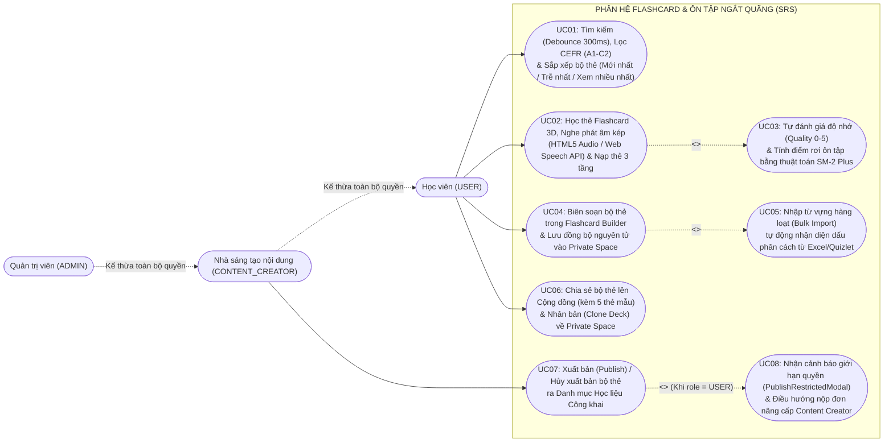
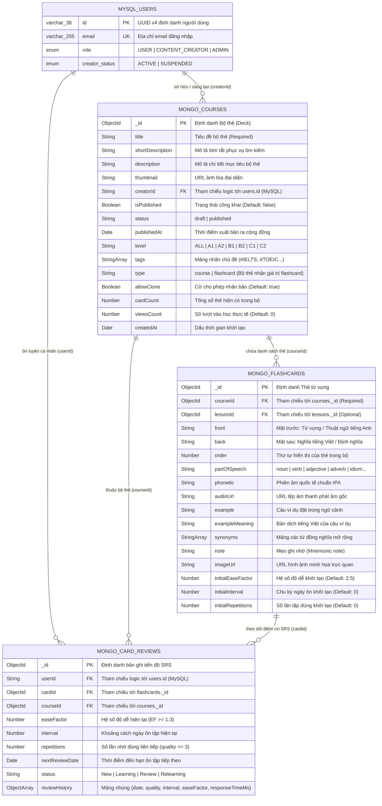

# NỘI DUNG BỔ SUNG BÁO CÁO ĐỒ ÁN LEXICORE — PHÂN HỆ FLASHCARD & SRS
*(Tài liệu được biên soạn đồng bộ 100% với văn phong tự sự học thuật và cấu trúc đề mục của cuốn báo cáo chính thức LexiCore)*

---

# PHASE 1: NỘI DUNG ĐIỀN VÀO CHƯƠNG 2 & CHƯƠNG 3

---

## 1. Nội dung điền vào Chương 2 — Mục 2.3.5 (Đặt ngay sau mục 2.3.4 Nguyên lý Game hóa học tập)

### 2.3.5 Nguyên lý Ôn tập ngắt quãng (Spaced Repetition - SRS) và Chủ động gợi nhớ (Active Recall)

Bên cạnh công nghệ luyện phát âm AI và cơ chế trò chơi hóa, trụ cột khoa học nhận thức thứ ba tạo nên giá trị cốt lõi của nền tảng LexiCore là sự kết hợp giữa nguyên lý Chủ động gợi nhớ (Active Recall), Lý thuyết Mã hóa kép (Dual Coding Theory) và thuật toán Ôn tập ngắt quãng cải tiến (SM-2 Plus). Các phương pháp học từ vựng truyền thống như chép từ nhiều lần hay đọc lướt danh sách từ vựng thường chỉ kích hoạt trí nhớ ngắn hạn; thông tin nhanh chóng bị mai một chỉ sau vài ngày do não bộ không thực hiện quá trình truy xuất chủ động. Để giải quyết triệt để hạn chế này, phân hệ Flashcard của LexiCore được thiết kế dựa trên mô hình toán học của Đường cong quên lãng (Forgetting Curve) do nhà tâm lý học người Đức Hermann Ebbinghaus công bố năm 1885. Theo Ebbinghaus, tỷ lệ lưu giữ thông tin trong trí nhớ con người suy giảm theo hàm mũ theo thời gian nếu không có sự ôn tập củng cố, được biểu diễn qua công thức:

$$R = e^{-\frac{t}{S}}$$

Trong đó, $R$ (Memory Retention) là khả năng lưu giữ thông tin trong trí nhớ (nhận giá trị từ $0$ đến $1$), $t$ là khoảng thời gian trôi qua kể từ lần tiếp xúc hoặc ôn tập gần nhất, và $S$ (Memory Strength) là độ bền vững tương đối của dấu vết ký ức trong não bộ. Quy luật này chỉ ra rằng thời điểm vàng để ôn tập một đơn vị kiến thức không phải là ngay lập tức khi vừa mới học, mà là ngay tại "điểm rơi" trước khi đường cong $R$ suy giảm xuống dưới ngưỡng quên lãng. Mỗi lần người học truy xuất lại từ vựng thành công tại đúng điểm rơi này, độ bền ký ức $S$ sẽ tăng lên theo cấp số nhân, làm cho độ dốc của đường cong quên lãng ngày càng thoải dần và chuyển hóa từ vựng từ trí nhớ ngắn hạn sang trí nhớ dài hạn.

Để tối đa hóa độ bền ký ức $S$ ngay từ lần tiếp xúc đầu tiên, cấu trúc mỗi tấm thẻ từ vựng trong LexiCore được thiết kế tuân theo Lý thuyết Mã hóa kép (Dual Coding Theory) của Allan Paivio kết hợp cùng nguyên lý Chủ động gợi nhớ (Active Recall). Theo Lý thuyết Mã hóa kép, bộ não con người xử lý thông tin qua hai kênh độc lập nhưng bổ trợ chặt chẽ cho nhau là kênh ngôn ngữ (văn bản, ngữ pháp, ngữ nghĩa) và kênh phi ngôn ngữ (âm thanh, hình ảnh trực quan). Thay vì chỉ lưu trữ hai mặt chữ đơn điệu, mỗi thẻ Flashcard trong hệ thống tích hợp đồng thời từ vựng gốc, phân loại từ loại, ký hiệu phiên âm quốc tế IPA, tệp âm thanh phát âm chuẩn (hoặc giọng đọc tổng hợp từ Web Speech API), hình ảnh minh họa, câu ví dụ đặt trong ngữ cảnh thực tế, mạng lưới từ đồng nghĩa và mẹo ghi nhớ. Khi bước vào phiên học trên giao diện FlashcardStudySession.tsx, nguyên lý Chủ động gợi nhớ được kích hoạt thông qua cơ chế phân tách hai mặt thẻ trong không gian ba chiều: hệ thống khóa trạng thái hiển thị đáp án ("showAnswer = false") và chỉ trình chiếu Mặt trước để buộc não bộ người học phải tự lục tìm nghĩa của từ trong ký ức. Chỉ sau khi người học thực hiện nỗ lực suy nghĩ và chủ động lật thẻ (nhấn phím Space hoặc nhấp chuột), Mặt sau mới xoay 180 độ để lộ toàn bộ ngữ nghĩa đối chiếu cùng bốn mức tự đánh giá độ nhớ.

Dựa trên phản hồi tự lượng giá của người học ở mỗi lượt lật thẻ, tầng nghiệp vụ của LexiCore (hiện thực hóa tại tệp srs.service.ts) vận hành thuật toán SM-2 Plus — một phiên bản nâng cấp từ thuật toán SuperMemo SM-2 kinh điển của Piotr Wozniak. Trong mô hình này, mỗi thẻ từ gắn với từng học viên được đặc trưng bởi ba tham số động: hệ số độ dễ $EF$ (Ease Factor, khởi tạo ở mức $2.5$ và luôn bị chặn dưới ở ngưỡng $EF \ge 1.3$ để tránh hiện tượng thẻ bị kẹt ở chu kỳ lặp quá dày đặc), số lần trả lời đúng liên tiếp $n$ (repetitions) và khoảng cách ngày ôn tập $I$ (interval). Sau mỗi lần lật thẻ với điểm đánh giá chất lượng ghi nhớ $q \in \{0, 2, 4, 5\}$ (tương ứng với các mức Quên/Sai, Khó, Nhớ, Rất dễ), hệ số độ dễ mới $EF'$ được hiệu chỉnh theo phương trình bậc hai:

$$EF' = \max\left(1.3,\; EF + \left(0.1 - (5 - q) \times (0.08 + (5 - q) \times 0.02)\right)\right)$$

Điểm cải tiến đắt giá của thuật toán SM-2 Plus trong LexiCore so với SM-2 nguyên bản nằm ở cơ chế thưởng trễ hạn (Overdue Bonus). Trong thực tế sử dụng, học viên có thể bận rộn và quay lại ôn tập trễ hơn dự kiến một số ngày $\Delta d$ ("delayDays"). Nếu học viên vẫn nhớ chính xác từ vựng sau khoảng thời gian trễ hạn đó ($q \ge 3$), điều đó chứng tỏ độ bền ký ức thực tế của họ đối với từ vựng này cao hơn ước tính lý thuyết. Thay vì chỉ nhân chu kỳ cũ với $EF'$ một cách cứng nhắc, thuật toán SM-2 Plus cộng thưởng một phần hoặc toàn bộ số ngày trễ hạn vào chu kỳ hiệu dụng trước khi nhân với hệ số độ dễ:

$$I_{\text{effective}} = \begin{cases} I + \Delta d & \text{nếu } q = 5 \text{ (Rất dễ)} \\ I + \dfrac{\Delta d}{2} & \text{nếu } 3 \le q < 5 \text{ (Nhớ)} \end{cases}, \quad I_{\text{new}} = \text{round}(I_{\text{effective}} \times EF')$$

Ngược lại, nếu học viên trả lời sai hoặc cảm thấy quá khó ($q < 3$), thuật toán lập tức đặt lại số lần nhớ liên tiếp về $0$ ($n = 0$), đưa khoảng cách ngày ôn về $0$ ($I = 0$) và chuyển trạng thái thẻ sang "Learning" để buộc học viên ôn luyện lại ngay trong ngày hôm đó. Sự phối hợp nhịp nhàng giữa mô hình nhận thức đa phương tiện trên giao diện và thuật toán lập lịch thích ứng SM-2 Plus ở tầng máy chủ giúp LexiCore cá nhân hóa hoàn toàn lộ trình ghi nhớ từng từ vựng cho mỗi học viên.

---

## 2. Nội dung bổ sung cho Chương 3 — Mục 3.1.1 Xác định các bên liên quan (Thay thế đoạn ghi chú tạm của phần Người tạo nội dung - Content Creator)

*(Hướng dẫn: Copy đoạn văn dưới đây thay thế cho đoạn "Người tạo nội dung (Content Creator)..." đang ghi chú tạm trong mục 3.1.1 của file Word)*

Người tạo nội dung (Content Creator) là những người dùng có chuyên môn ngoại ngữ (giảng viên, trợ giảng, hoặc học viên trình độ cao) đã nộp hồ sơ đăng ký kèm chứng chỉ năng lực và được Quản trị viên (Admin) phê duyệt nâng cấp vai trò từ tài khoản USER thông thường lên CONTENT_CREATOR (với trạng thái hoạt động ACTIVE). Trong kiến trúc phân quyền của LexiCore, hệ thống thiết lập cơ chế phân tách minh bạch giữa quyền khởi tạo học liệu cá nhân và quyền xuất bản học liệu công khai. Cụ thể, đối với các tài khoản Học viên (USER) thông thường, hệ thống vẫn cấp quyền truy cập vào công cụ biên soạn Flashcard Builder và tính năng nhập từ vựng hàng loạt (Bulk Import) để tự tạo các bộ thẻ từ vựng riêng biệt hoặc nhân bản (Clone) bộ thẻ từ cộng đồng; tuy nhiên, các bộ thẻ do USER tạo ra chỉ được phép lưu trữ ở chế độ bản nháp riêng tư trong Không gian cá nhân (Private Space) để phục vụ mục đích tự ôn luyện theo thuật toán SRS của chính họ. Ngược lại, vai trò Content Creator được trao đặc quyền xuất bản (Publish) các khóa học, bộ thẻ Flashcard và đề thi từ Creator Studio ra danh mục học liệu công khai trên toàn hệ thống. Khi một bộ thẻ được Content Creator xuất bản, toàn bộ cộng đồng học viên trên nền tảng đều có thể tìm kiếm, lọc theo trình độ CEFR, vào học trực tiếp và sao chép về không gian cá nhân, đồng thời Content Creator được cung cấp các công cụ theo dõi thống kê lượt xem thực tế ("viewsCount") và quản trị bản quyền cho phép hoặc chặn nhân bản ("allowClone") đối với từng bộ thẻ của mình.

---

## 3. Nội dung điền vào Chương 3 — Mục 3.2.8 Module Flashcard & SRS (Điền vào mục 3.2.8 đang để trống trong file Word)

### 3.2.8 Module Flashcard & SRS

Module Flashcard & SRS đóng vai trò là phân hệ tích lũy và duy trì vốn từ vựng dài hạn của nền tảng LexiCore, kết nối chặt chẽ giữa kho học liệu chung của hệ thống, không gian tự học cá nhân (Private Space), công cụ biên soạn chuyên sâu (Creator Studio) và mạng xã hội học tập (Community). Yêu cầu chức năng của phân hệ được thiết kế xuyên suốt theo bốn luồng nghiệp vụ khép kín từ khám phá học liệu, tương tác học tập 3D, biên soạn đa phương tiện cho đến chia sẻ cộng đồng.

Về quản lý danh mục khám phá, tìm kiếm và bộ lọc đa tiêu chí, hệ thống phải cung cấp giao diện thư viện bộ thẻ công khai (FlashcardsView.tsx) hiển thị toàn bộ các bộ thẻ đã được xuất bản ("isPublished = true") kèm theo tiến độ học tập cá nhân hóa của chính người dùng đang đăng nhập trên từng bộ thẻ, bao gồm tổng số thẻ, số thẻ mới chưa học, số thẻ đang đến hạn cần ôn tập ngay và thanh tỷ lệ phần trăm ghi nhớ. Để giúp học viên định vị nhanh bộ thẻ phù hợp trong kho dữ liệu lớn, thanh công cụ lọc thông minh (CatalogFilterBar.tsx) phải hỗ trợ đồng thời ba cơ chế truy vấn. Thứ nhất là tìm kiếm từ khóa đa trường không phân biệt chữ hoa chữ thường (quét trên tiêu đề, mô tả ngắn, mô tả chi tiết và mảng nhãn chủ đề "tags"), được tích hợp kỹ thuật trì hoãn truy vấn Debounce 300ms nhằm đảm bảo chỉ khi người dùng ngừng gõ phím 300ms thì trình duyệt mới phát sinh yêu cầu HTTP xuống máy chủ, qua đó triệt tiêu hoàn toàn hiện tượng gửi truy vấn dồn dập gây nghẽn mạng. Thứ hai là bộ lọc phân tầng trình độ ngoại ngữ theo đúng Khung tham chiếu trình độ ngôn ngữ chung của Châu Âu (CEFR) với các nút chọn trực quan từ A1, A2, B1, B2, C1 đến C2 (cùng tùy chọn ALL hiển thị tất cả). Thứ ba là chức năng sắp xếp danh mục theo ba tiêu chí: Mới nhất ("newest" - ưu tiên các bộ thẻ vừa được xuất bản theo "createdAt" giảm dần), Trễ nhất ("oldest" - sắp xếp theo thời gian tạo tăng dần), và Xem nhiều nhất ("most_viewed" - sắp xếp theo số lượt vào học thực tế "viewsCount" giảm dần). Đặc biệt, chỉ số "viewsCount" của mỗi bộ thẻ phải được cập nhật một cách trung thực và nguyên tử thông qua toán tử "$inc" của MongoDB mỗi khi có một học viên thực sự bấm vào bộ thẻ để bắt đầu phiên học.

Về trải nghiệm buồng học Flashcard 3D tương tác và đồng bộ thuật toán SM-2 Plus, khi người dùng chọn một bộ thẻ để bắt đầu ôn luyện (FlashcardStudySession.tsx), hệ thống phải đảm bảo luôn nạp đủ danh sách thẻ học tập thông qua chiến lược truy vấn 3 tầng thông minh tại tầng máy chủ (hàm "getDueCards" trong srs.controller.ts). Ở tầng ưu tiên thứ nhất, hệ thống trích xuất các thẻ đã đến hoặc quá hạn ôn tập ("nextReviewDate <= now") từ tập hợp dữ liệu "CardReview" của người học. Nếu số lượng thẻ đến hạn chưa lấp đầy giới hạn của một phiên học (mặc định 20 thẻ/phiên), tầng thứ hai sẽ tự động lấy tiếp các thẻ từ vựng mới ("status: 'New'") trong bộ thẻ mà người học chưa từng tiếp xúc. Trong trường hợp người học đã hoàn thành toàn bộ thẻ trong bộ và chưa có thẻ nào đến kỳ hạn mới nhưng vẫn muốn chủ động ôn luyện củng cố trước kỳ thi, tầng thứ ba sẽ tự động nạp các thẻ còn lại ở chế độ luyện tập tổng hợp ("status: 'Practice'"), đảm bảo phiên học không bao giờ rơi vào trạng thái màn hình trống. Trong buồng học, tấm thẻ phải được dựng trong không gian phối cảnh ba chiều ("perspective: 1000px" và "transform-style: preserve-3d"), cho phép lật mượt mà giữa Mặt trước (từ vựng, từ loại, phiên âm IPA, ảnh minh họa) và Mặt sau (nghĩa tiếng Việt, câu ví dụ ngữ cảnh, bản dịch ví dụ, từ đồng nghĩa, mẹo ghi nhớ). Hệ thống phải tích hợp cơ chế phát âm kép tự động: ưu tiên phát tệp âm thanh gốc ("audioUrl") qua luồng HTML5 Audio; nếu thẻ không có tệp âm thanh đính kèm hoặc gặp lỗi đường truyền, hệ thống tự động chuyển đổi dự phòng (Fallback) sang bộ tổng hợp giọng nói Web Speech API ("window.speechSynthesis") của trình duyệt với giọng đọc tiếng Anh chuẩn Mỹ ("en-US", tốc độ "rate = 0.95"). Toàn bộ quá trình học phải hỗ trợ điều khiển rảnh tay hoàn toàn bằng bàn phím: phím Space để lật thẻ, phím mũi tên trái/phải để chuyển thẻ và cụm phím số 1, 2, 3, 4 để chấm điểm mức độ nhớ (Sai, Khó, Nhớ, Dễ). Ngay khi học viên chấm điểm, hệ thống tự động đo thời gian phản hồi tính bằng mili-giây ("responseTimeMs") và gửi về endpoint "/api/v1/srs/review" để thực thi thuật toán SM-2 Plus, tính toán điểm rơi ôn tập tiếp theo và cập nhật biểu đồ nhiệt (Heatmap) 30 ngày chuyên cần.

Về công cụ biên soạn bộ thẻ đa phương tiện (Flashcard Builder) và tính năng nhập liệu hàng loạt (Bulk Import), hệ thống phải cung cấp một môi trường thiết kế học liệu chuyên nghiệp (FlashcardBuilder.tsx) với bố cục chia đôi màn hình: khung bên trái là danh sách các thẻ từ vựng cho phép thêm mới, nhân bản nhanh, xóa, thay đổi thứ tự vị trí và nhập liệu chi tiết các trường ngữ pháp; khung bên phải là mô-đun Xem thử trực tiếp (Live Student Preview) phản chiếu tức thời giao diện lật thẻ 3D của thẻ đang được chọn chỉnh sửa. Để giải phóng người dùng khỏi việc gõ thủ công từng thẻ khi cần tạo các bộ từ vựng lớn hàng trăm từ, cửa sổ nhập hàng loạt (BulkImportModal.tsx) phải cho phép người dùng sao chép và dán trực tiếp dữ liệu văn bản thô từ bảng tính Excel, Google Sheets, Quizlet hoặc Anki. Thuật toán tiền xử lý phía trình duyệt phải tự động nhận diện ký tự phân tách cột (ký tự Tab "\t", dấu gạch đứng "|", dấu chấm phẩy ";" hoặc dấu gạch ngang " - ") trên từng dòng, tự động bóc tách linh hoạt từ cấu trúc 2 cột (Từ vựng - Nghĩa) đến 5 cột (Từ vựng - Loại từ - Phiên âm - Nghĩa - Câu ví dụ), chuẩn hóa dấu gạch chéo "/.../" cho phiên âm IPA và hiển thị bảng kiểm tra trực quan báo cáo số dòng hợp lệ/lỗi trước khi cho phép nối tiếp ("append") hoặc ghi đè ("replace") vào danh sách thẻ. Khi lưu bộ thẻ, hệ thống thực hiện đồng bộ hóa nguyên tử toàn bộ thông tin bộ thẻ và mảng thẻ qua một yêu cầu duy nhất ("POST /api/v1/creator/decks/save-full"), bảo toàn định danh "_id" của các thẻ cũ để không làm đứt gãy lịch sử ôn tập SRS của các học viên đang theo học, đồng thời tự động khởi tạo ngay các bản ghi "CardReview" cho chính người tạo.

Về cơ chế Không gian cá nhân (Private Space), kiểm soát quyền xuất bản (RBAC) và chia sẻ/nhân bản cộng đồng (Community Synergy), hệ thống phải cung cấp phân hệ Private Space (PrivateSpaceView.tsx) làm kho lưu trữ học liệu riêng tư cho mọi tài khoản đã đăng nhập. Cả Học viên (USER) và Nhà sáng tạo nội dung (CONTENT_CREATOR) đều có thể lưu bộ thẻ ở trạng thái bản nháp riêng tư ("isPublished = false", "status = 'draft'") trong Private Space để tự học và tự ôn tập định kỳ. Tuy nhiên, khi người dùng nhấn nút "Xuất bản ra Cộng đồng" ("isPublished = true"), hệ thống áp dụng cơ chế kiểm tra phân quyền hai lớp: nếu người dùng chỉ mang vai trò USER thông thường (hoặc tài khoản Creator đang bị tạm đình chỉ "SUSPENDED"), giao diện sẽ chặn thao tác xuất bản và bật hộp thoại PublishRestrictedModal.tsx (đồng thời tầng Backend chặn bằng mã lỗi "403 Forbidden" kèm cờ "requires_creator: true"), qua đó giải thích rõ quyền hạn lưu nháp tự học và cung cấp nút điều hướng trực tiếp sang trang Hồ sơ cá nhân để người dùng nộp đơn đăng ký nâng cấp lên Content Creator. Cuối cùng, từ Private Space, người dùng có thể chia sẻ bộ thẻ của mình lên bảng tin Cộng đồng thông qua cửa sổ ShareDeckModal.tsx; hệ thống sẽ tự động trích xuất 5 thẻ đầu tiên làm dữ liệu mẫu ("sampleCards") nhúng vào bài viết trên bảng tin (PostCard.tsx) để các thành viên khác có thể lật xem thử trực tiếp ngay trên bài đăng và nhấn nút "Lưu bộ thẻ (Clone Deck)" nhằm sao chép toàn bộ bộ thẻ cùng lịch sử khởi tạo SRS về Private Space của riêng họ (nếu bộ thẻ gốc bật cờ "allowClone = true").

---

## 4. Nội dung điền vào Chương 3 — Mục 3.4.3 Use Case chi tiết - Luồng Học tập và Quản trị Flashcard SRS (Đặt ngay sau mục 3.4.2 Use Case chi tiết - Luồng Shadowing)

### 3.4.3 Use Case chi tiết - Luồng Học tập và Quản trị Flashcard SRS

Nếu như luồng AI Shadowing tập trung vào quá trình tương tác với dịch vụ nhận diện giọng nói bên ngoài, thì luồng Học tập và Quản trị Flashcard SRS lại thể hiện rõ nét sự phối hợp nội tại giữa cơ chế phân quyền hai tầng (Private Space và Public Catalog), thuật toán đồng bộ dữ liệu bán cấu trúc trên MongoDB và thuật toán lập lịch ôn tập ngắt quãng SM-2 Plus. Sơ đồ Use Case dưới đây mô tả tổng thể các ca sử dụng và mối quan hệ kế thừa quyền hạn giữa ba tác nhân Học viên (User), Nhà sáng tạo nội dung (Content Creator) và Quản trị viên (Admin) trong phân hệ Flashcard:



Hình 3.x: Sơ đồ Use Case chi tiết của phân hệ Flashcard & SRS.

Để làm rõ luồng đi của dữ liệu trong thực tế vận hành, sơ đồ tuần tự (Sequence Diagram) dưới đây đặc tả chi tiết hai giai đoạn quan trọng nhất của phân hệ: Giai đoạn 1 là quá trình người dùng biên soạn bộ thẻ kết hợp nhập hàng loạt (Bulk Import), kiểm tra phân quyền xuất bản RBAC và lưu đồng bộ nguyên tử xuống MongoDB; Giai đoạn 2 là quá trình học viên tìm kiếm, lọc bộ thẻ theo cấp độ CEFR, kích hoạt phiên học 3D với cơ chế nạp thẻ 3 tầng và chấm điểm ghi nhớ theo thuật toán SM-2 Plus:

```mermaid
sequenceDiagram
    autonumber
    actor Actor as Người dùng<br/>(USER / CONTENT_CREATOR)
    participant UI as Giao diện React SPA<br/>(Builder / FilterBar / StudySession)
    participant CreatorAPI as Creator Controller<br/>(/api/v1/creator/decks)
    participant SrsAPI as SRS Controller & Service<br/>(/api/v1/srs & calculateSM2Plus)
    participant MongoDB as MongoDB Atlas<br/>(courses, flashcards, cardreviews)

    rect rgb(245, 247, 250)
        Note over Actor,MongoDB: GIAI ĐOẠN 1: BIÊN SOẠN BỘ THẺ, BULK IMPORT & KIỂM SOÁT QUYỀN XUẤT BẢN (RBAC)
        Actor->>UI: Mở FlashcardBuilder & dán văn bản từ Excel/Quizlet vào BulkImportModal
        UI->>UI: Chạy detectDelimiter(\t, |, ;, -) & bóc tách thành mảng ParsedCard[]
        Actor->>UI: Nhấn "Lưu bản nháp" (isPublished=false) hoặc "Xuất bản" (isPublished=true)
        alt Người dùng chọn Xuất bản nhưng có role = USER (!isCreatorOrAdmin)
            UI-->>Actor: Hiển thị PublishRestrictedModal (Đề xuất Lưu nháp hoặc Đăng ký làm Creator)
        else Lưu nháp vào Private Space hoặc Xuất bản hợp lệ (CONTENT_CREATOR / ADMIN)
            UI->>CreatorAPI: POST /api/v1/creator/decks/save-full { deck, cards }
            CreatorAPI->>CreatorAPI: Kiểm tra bảo mật kép canPublishContent(req) (Chặn 403 nếu giả mạo request)
            CreatorAPI->>MongoDB: Tạo mới hoặc cập nhật tài liệu Course (type: 'flashcard')
            CreatorAPI->>MongoDB: Đối chiếu existingCardMap: Cập nhật thẻ cũ, thêm thẻ mới & xóa thẻ thừa ($nin)
            CreatorAPI->>MongoDB: Cập nhật cardCount & tự động Upsert CardReview (status: 'New') cho tác giả
            CreatorAPI-->>UI: Trả về HTTP 200 OK { deck, cards }
        end
    end

    rect rgb(242, 249, 245)
        Note over Actor,MongoDB: GIAI ĐOẠN 2: TRUY VẤN ĐA TIÊU CHÍ, NẠP THẺ 3 TẦNG & HỌC THẺ 3D VỚI SM-2 PLUS
        Actor->>UI: Nhập từ khóa (Debounce 300ms), chọn cấp độ CEFR (A1-C2) & kiểu sắp xếp
        UI->>SrsAPI: GET /api/v1/srs/decks?search=...&level=...&sort=...
        SrsAPI->>MongoDB: Truy vấn Course.find(query).sort(sortObj) & Aggregate tiến độ CardReview
        MongoDB-->>SrsAPI: Trả về danh sách bộ thẻ khớp điều kiện kèm thống kê cá nhân
        SrsAPI-->>UI: Trả về JSON danh sách bộ thẻ hiển thị lên lưới giao diện

        Actor->>UI: Nhấn "Học ngay" trên một bộ thẻ -> Mở FlashcardStudySession
        UI->>SrsAPI: GET /api/v1/srs/due?courseId=<deckId>&limit=20
        SrsAPI->>MongoDB: Tăng nguyên tử lượt xem: Course.findByIdAndUpdate(courseId, { $inc: { viewsCount: 1 } })
        SrsAPI->>MongoDB: Nạp thẻ 3 tầng: (1) Thẻ đến hạn Due -> (2) Thẻ mới New -> (3) Thẻ luyện tập Practice
        MongoDB-->>SrsAPI: Trả về mảng thẻ đầy đủ thông tin đa phương tiện
        SrsAPI-->>UI: Trả về { totalDue, cards } -> Render Mặt trước thẻ 3D

        Actor->>UI: Bấm nghe phát âm (Audio/Web Speech API), nhấn Space lật thẻ 3D & bấm phím 1-4 chấm điểm
        UI->>UI: Đo thời gian suy nghĩ: responseTimeMs = Date.now() - cardStartTime
        UI->>SrsAPI: POST /api/v1/srs/review { cardId, courseId, quality, responseTimeMs }
        SrsAPI->>SrsAPI: Thực thi calculateSM2Plus() tính easeFactor, interval (kèm Overdue Bonus) & nextReviewDate
        SrsAPI->>MongoDB: Cập nhật bản ghi CardReview & đẩy nhật ký vào mảng reviewHistory[]
        SrsAPI-->>UI: Trả về HTTP 200 OK -> Chuyển sang thẻ tiếp theo trong phiên học
    end
```

Hình 3.y: Sơ đồ Sequence đặc tả luồng Biên soạn bộ thẻ, Truy vấn học liệu và Ôn tập ngắt quãng SM-2 Plus.

Nhìn vào sơ đồ tuần tự trên, có thể thấy toàn bộ quá trình tương tác được bảo vệ chặt chẽ ở cả hai đầu giao diện và máy chủ. Ở giai đoạn khởi tạo học liệu, việc tách biệt xử lý bóc tách chuỗi văn bản ("detectDelimiter") ngay trên trình duyệt giúp người dùng nhận được bảng xem trước tức thì mà không tốn băng thông mạng, trong khi thao tác lưu trữ xuống cơ sở dữ liệu chỉ diễn ra một lần duy nhất thông qua cơ chế đồng bộ nguyên tử ("saveFullDeck"). Ở giai đoạn học tập, mỗi thao tác truy vấn danh mục hay bắt đầu phiên học đều tận dụng tối đa hệ thống chỉ mục phức hợp của MongoDB để vừa cập nhật số lượt xem thực tế ("viewsCount"), vừa tổng hợp danh sách thẻ theo ba tầng ưu tiên và tính toán chính xác điểm rơi ký ức bằng thuật toán SM-2 Plus chỉ trong vài chục mili-giây.


---
---

# PHASE 2: NỘI DUNG ĐIỀN VÀO CHƯƠNG 4 (THIẾT KẾ HỆ THỐNG)

---

## 1. Nội dung bổ sung cho Chương 4 — Mục 4.2.1 Sơ đồ quan hệ thực thể (ERD) & Mục 4.2.2 Đặc tả chi tiết các bảng/collection chính (MongoDB)

### 4.2.1 Sơ đồ quan hệ thực thể (ERD) — Bổ sung kiến trúc lưu trữ MongoDB của Phân hệ Flashcard & SRS

*(Hướng dẫn: Đặt đoạn văn và sơ đồ Mermaid dưới đây nối tiếp ngay sau Hình 4.2 Sơ đồ ERD cơ sở dữ liệu MySQL trong mục 4.2.1 của file Word)*

Bên cạnh hệ quản trị cơ sở dữ liệu quan hệ MySQL dùng để lưu trữ dữ liệu định danh và giao dịch tài chính đòi hỏi tính toàn vẹn ACID, hệ thống LexiCore triển khai kiến trúc lưu trữ đa cơ sở dữ liệu (Polyglot Persistence) bằng cách sử dụng MongoDB Atlas cho toàn bộ học liệu của phân hệ Flashcard & SRS. Việc lựa chọn mô hình hướng tài liệu (Document-oriented) của MongoDB xuất phát từ đặc thù cấu trúc dữ liệu của thẻ từ vựng ngoại ngữ: một thẻ từ không chỉ chứa từ vựng và nghĩa tĩnh mà còn bao hàm mảng các từ đồng nghĩa có độ dài biến thiên ("synonyms"), câu ví dụ, mẹo ghi nhớ, đường dẫn đa phương tiện cùng mảng lịch sử tất cả các lần lật thẻ ("reviewHistory") của từng học viên. Sự kết nối xuyên cơ sở dữ liệu (Cross-Database Reference) giữa MySQL và MongoDB được thiết lập thông qua khóa liên kết logic là định danh "id" (kiểu chuỗi UUID v4) của bảng "users" trong MySQL, được tham chiếu trực tiếp vào trường "creatorId" của tập hợp "courses" và trường "userId" của tập hợp "cardreviews" trong MongoDB. Sơ đồ quan hệ thực thể dưới đây biểu diễn chi tiết cấu trúc liên kết giữa bảng người dùng MySQL và các Collection MongoDB của phân hệ:



Hình 4.x: Sơ đồ quan hệ thực thể (ERD) các Collection MongoDB của phân hệ Flashcard & SRS và liên kết với bảng users (MySQL).

---

### 4.2.2 Đặc tả chi tiết các bảng/collection chính — Bổ sung đặc tả các Collection MongoDB

*(Hướng dẫn: Copy các đoạn văn tự sự và bảng tổng hợp dưới đây đặt nối tiếp vào cuối mục 4.2.2 trong file Word, ngay sau đoạn mô tả bảng arena_matches)*

Tập hợp dữ liệu courses (định nghĩa tại tệp Course.ts) đảm nhận vai trò lưu trữ thông tin định danh và siêu dữ liệu quản trị của các bộ thẻ từ vựng (khi trường phân loại "type" mang giá trị "flashcard") cũng như các khóa học trực tuyến trên nền tảng. Khóa chính "_id" sử dụng kiểu "ObjectId" tự sinh của MongoDB, trong khi trường khóa ngoại logic "creatorId" lưu trữ chuỗi UUID tham chiếu trực tiếp đến người dùng sở hữu bộ thẻ trong bảng "users" của MySQL. Để giải quyết bài toán phân tách giữa kho tự học cá nhân (Private Space) và danh mục công khai mà không cần tách thành hai bảng vật lý rời rạc, tập hợp này sử dụng cặp trường trạng thái "isPublished" (kiểu Boolean, mặc định là "false") và "status" (nhận hai giá trị "draft" hoặc "published"). Khi một học viên (USER) tự tạo bộ thẻ hoặc nhân bản bộ thẻ từ cộng đồng, bản ghi sẽ có "isPublished = false" để chỉ hiển thị trong không gian riêng tư của người đó; chỉ khi một Content Creator thực hiện xuất bản, cờ "isPublished" mới chuyển sang "true" kèm dấu thời gian "publishedAt". Trường "level" lưu trữ cấp bậc ngoại ngữ theo chuẩn CEFR từ "A1" đến "C2" (mặc định là "B1"), phục vụ trực tiếp cho bộ lọc trình độ trên giao diện khám phá. Ngoài ra, trường "allowClone" (mặc định là "true") cho phép tác giả kiểm soát quyền sở hữu trí tuệ khi chia sẻ bộ thẻ lên Cộng đồng, trường "cardCount" lưu tổng số thẻ hiện có để tránh phải thực hiện truy vấn đếm "COUNT" tốn kém mỗi khi hiển thị danh sách, và trường "viewsCount" ghi nhận số lượt học viên thực sự bấm vào học bộ thẻ để làm cơ sở cho thuật toán sắp xếp theo độ phổ biến ("Xem nhiều nhất").

Tập hợp dữ liệu flashcards (định nghĩa tại tệp Flashcard.ts) lưu trữ chi tiết từng tấm thẻ từ vựng đa phương tiện nằm bên trong một bộ thẻ thông qua khóa ngoại "courseId" tham chiếu tới "courses._id". Thiết kế của tập hợp này hiện thực hóa trực tiếp Lý thuyết Mã hóa kép (Dual Coding Theory) bằng cách mở rộng cấu trúc thẻ vượt ra ngoài hai trường bắt buộc là "front" (từ vựng hoặc thuật ngữ tiếng Anh ở mặt trước) và "back" (nghĩa tiếng Việt ở mặt sau). Cụ thể, mỗi tài liệu thẻ tích hợp đầy đủ các trường ngữ pháp và đa phương tiện gồm: "partOfSpeech" (phân loại từ loại theo 9 nhóm: "noun", "verb", "adjective", "adverb", "idiom", "phrase", "preposition", "conjunction", "other"), "phonetic" (phiên âm quốc tế chuẩn IPA), "audioUrl" (liên kết tệp âm thanh phát âm chuẩn), "imageUrl" (hình ảnh minh họa trực quan), "example" và "exampleMeaning" (câu ví dụ ngữ cảnh kèm bản dịch tiếng Việt), mảng chuỗi "synonyms" (danh sách các từ đồng nghĩa) và "note" (ghi chú mẹo ghi nhớ Mnemonic). Trường số nguyên "order" quy định vị trí sắp xếp tuần tự của thẻ trong bộ, đồng thời ba trường "initialEaseFactor" (mặc định 2.5), "initialInterval" (mặc định 0) và "initialRepetitions" (mặc định 0) đóng vai trò là bộ tham số gốc để khởi tạo trạng thái ban đầu cho thuật toán ôn tập ngắt quãng.

Tập hợp dữ liệu cardreviews (định nghĩa tại tệp CardReview.ts) là trái tim của thuật toán SM-2 Plus, đóng vai trò bảng trung gian theo dõi tiến độ ghi nhớ độc lập của từng học viên ("userId") trên từng tấm thẻ từ vựng ("cardId") thuộc một bộ thẻ xác định ("courseId"). Hệ thống áp đặt ràng buộc duy nhất (Unique Compound Index) trên cặp khóa "{ userId: 1, cardId: 1 }" nhằm đảm bảo mỗi học viên chỉ tồn tại duy nhất một dòng trạng thái nhận thức cho mỗi thẻ từ vựng. Các trường động được cập nhật liên tục sau mỗi lần lật thẻ bao gồm: "easeFactor" (hệ số độ dễ cá nhân hóa, luôn được bảo vệ ở ngưỡng tối thiểu 1.3), "interval" (khoảng cách ngày ôn tập hiện tại), "repetitions" (số lần học viên nhớ đúng liên tiếp với điểm đánh giá "quality >= 3"), "nextReviewDate" (mốc thời gian điểm rơi cần ôn tập lại) và "status" (trạng thái vòng đời nhận thức của thẻ gồm 4 giai đoạn: "New", "Learning", "Review", "Relearning"). Điểm ưu việt trong thiết kế NoSQL của bảng "cardreviews" là việc sử dụng mảng tài liệu con nhúng trực tiếp "reviewHistory", trong đó mỗi phần tử lưu lại toàn bộ dấu vết của một lần lật thẻ gồm ngày giờ ("date"), điểm tự đánh giá ("quality"), chu kỳ mới ("interval"), hệ số dễ mới ("easeFactor") và thời gian suy nghĩ tính bằng mili-giây ("responseTimeMs"). Cách thiết kế nhúng này giúp hệ thống vừa có thể truy xuất tức thời ngày ôn tập gần nhất ("previousReviewDate") để tính phần thưởng trễ hạn (Overdue Bonus), vừa tổng hợp được biểu đồ nhiệt chuyên cần (Heatmap 30 ngày) bằng MongoDB Aggregation Pipeline mà không cần thực hiện bất kỳ phép kết nối bảng phức tạp nào.

| COLLECTION | TRƯỜNG KHÓA & CHỈ MỤC CHÍNH | CÁC TRƯỜNG DỮ LIỆU NGHIỆP VỤ CỐT LÕI | VAI TRÒ TRONG PHÂN HỆ FLASHCARD & SRS |
| :--- | :--- | :--- | :--- |
| courses | "_id" (PK), "creatorId" (FK logic), "isPublished", "type", "level", "viewsCount" | "title", "shortDescription", "description", "thumbnail", "status" (draft/published), "tags[]", "allowClone", "cardCount", "publishedAt" | Lưu trữ siêu dữ liệu Bộ thẻ ("type = 'flashcard'"), phân tách trạng thái nháp cá nhân (Private Space) và công khai, phục vụ tìm kiếm, lọc CEFR và thống kê lượt học. |
| flashcards | "_id" (PK), "courseId" (FK tham chiếu courses), "lessonId" (FK tùy chọn), "order" | "front", "back", "partOfSpeech", "phonetic", "audioUrl", "example", "exampleMeaning", "synonyms[]", "note", "imageUrl", "initialEaseFactor" (2.5) | Lưu trữ nội dung thẻ từ vựng đa phương tiện theo Lý thuyết Mã hóa kép, cung cấp dữ liệu hiển thị cho buồng học 3D và trình biên soạn Flashcard Builder. |
| cardreviews | "_id" (PK), "{ userId, cardId }" (Unique Index), "courseId", "nextReviewDate" | "easeFactor" ($\ge 1.3$), "interval", "repetitions", "status" (New/Learning/Review/Relearning), "reviewHistory[]" (nhúng lịch sử & responseTimeMs) | Lưu trữ trạng thái nhận thức cá nhân hóa theo thuật toán SM-2 Plus, xác định danh sách thẻ đến hạn ôn tập và kết xuất biểu đồ nhiệt học tập. |

Bảng 4.x: Tổng hợp cấu trúc các Collection MongoDB của phân hệ Flashcard & SRS.

---

## 2. Nội dung điền vào Chương 4 — Mục 4.3.8 Module Flashcard & SRS (Điền vào mục 4.3.8 đang để trống trong file Word)

### 4.3.8 Module Flashcard & SRS (/api/v1/srs, /api/v1/creator & /api/community)

Bảng dưới đây đặc tả toàn bộ các RESTful API phục vụ cho luồng khám phá danh mục bộ thẻ, nạp thẻ 3 tầng, chấm điểm ôn tập ngắt quãng SM-2 Plus, quản trị Không gian cá nhân (Private Space), biên soạn bộ thẻ trong Creator Studio và chia sẻ/nhân bản bộ thẻ trên Cộng đồng:

| METHOD | ENDPOINT | XÁC THỰC | MÔ TẢ |
| :--- | :--- | :--- | :--- |
| GET | /api/v1/srs/decks | JWT | Lấy danh sách bộ thẻ công khai kèm tiến độ cá nhân; hỗ trợ tìm kiếm đa trường ("search"), lọc trình độ CEFR ("level" từ A1 đến C2) và sắp xếp ("sort": newest, oldest, most_viewed) |
| GET | /api/v1/srs/due | JWT | Tăng nguyên tử "viewsCount" của bộ thẻ lên 1 và nạp danh sách thẻ cho phiên học theo chiến lược 3 tầng (Thẻ đến hạn Due $\rightarrow$ Thẻ mới New $\rightarrow$ Thẻ luyện tập Practice) |
| POST | /api/v1/srs/review | JWT | Gửi kết quả đánh giá độ nhớ ("quality" $\in \{0..5\}$, "responseTimeMs") sau khi lật thẻ; thực thi thuật toán SM-2 Plus cập nhật "easeFactor", "interval", "nextReviewDate" và lưu vết "reviewHistory" |
| GET | /api/v1/srs/stats | JWT | Thống kê tổng quan số lượng thẻ theo 4 trạng thái (New, Learning, Due, Mastered) và kết xuất dữ liệu biểu đồ nhiệt (Heatmap) hoạt động ôn tập trong 30 ngày gần nhất |
| GET | /api/v1/creator/private-space | JWT (User / Creator / Admin) | Lấy toàn bộ danh sách bộ thẻ Flashcard, khóa học và đề thi do chính người dùng tạo (bản nháp Private hoặc đã Publish) kèm bộ thẻ đã nhân bản để tự học trong Private Space |
| GET | /api/v1/creator/decks/:id | JWT (User / Creator / Admin) | Lấy chi tiết thông tin một bộ thẻ và toàn bộ mảng thẻ từ vựng bên trong (sắp xếp theo "order" tăng dần) để nạp vào trình biên soạn Flashcard Builder |
| POST | /api/v1/creator/decks/save-full | JWT (User lưu nháp / Creator được Publish) | Đồng bộ hóa nguyên tử toàn bộ thông tin bộ thẻ và danh sách thẻ (thêm mới, cập nhật thẻ giữ lại, xóa thẻ bị loại bỏ), tự động khởi tạo bản ghi "CardReview" cho tác giả và kiểm tra quyền xuất bản |
| POST | /api/v1/creator/decks/:id/publish | Content Creator / Admin | Xuất bản bộ thẻ từ chế độ nháp trong Private Space ra danh mục học liệu công khai (kiểm tra bộ thẻ phải có ít nhất 1 thẻ từ vựng hợp lệ) |
| POST | /api/v1/creator/decks/:id/unpublish | Content Creator / Admin | Hủy xuất bản bộ thẻ công khai, thu hồi bộ thẻ về lại trạng thái bản nháp riêng tư ("status = 'draft'", "isPublished = false") |
| POST | /api/v1/creator/decks/:id/clone | JWT (User / Creator / Admin) | Nhân bản trực tiếp một bộ thẻ (nếu "allowClone !== false") cùng toàn bộ thẻ từ vựng sang một bản sao độc lập trong Private Space của người dùng và khởi tạo tiến độ SRS mới |
| GET | /api/v1/creator/courses/:courseId/flashcards | JWT (User / Creator / Admin) | Lấy danh sách toàn bộ các thẻ từ vựng thuộc về một bộ thẻ hoặc khóa học xác định theo thứ tự "order" tăng dần |
| POST | /api/v1/creator/flashcards | JWT (User / Creator / Admin) | Tạo lẻ một thẻ từ vựng mới vào bộ thẻ và tự động cập nhật lại tổng số lượng thẻ ("cardCount") |
| PUT | /api/v1/creator/flashcards/:id | JWT (User / Creator / Admin) | Cập nhật nội dung đa phương tiện (từ vựng, nghĩa, IPA, audio, ví dụ, từ đồng nghĩa, thứ tự) của một thẻ từ vựng cụ thể |
| DELETE | /api/v1/creator/flashcards/:id | JWT (User / Creator / Admin) | Xóa một thẻ từ vựng khỏi bộ thẻ, đồng thời xóa sạch các bản ghi tiến độ "CardReview" liên quan và giảm "cardCount" đi 1 |
| POST | /api/community/share-deck | JWT | Chia sẻ một bộ thẻ từ Private Space lên bảng tin Cộng đồng, tự động trích xuất 5 thẻ đầu tiên làm dữ liệu mẫu ("sampleCards") để người dùng khác lật xem thử trực tiếp |
| POST | /api/community/posts/:id/clone-deck | JWT | Nhân bản bộ thẻ được đính kèm trong bài viết Cộng đồng về Private Space của người nhận và tăng bộ đếm lượt sao chép ("stats.clonesCount") của bài viết lên 1 |
| POST | /api/creator/apply | JWT (User) | Nộp đơn đăng ký nâng cấp tài khoản từ Học viên (USER) lên Nhà sáng tạo nội dung (CONTENT_CREATOR) để mở khóa quyền xuất bản bộ thẻ công khai (kiểm tra thời gian chờ 24 giờ nếu từng bị từ chối) |
| GET | /api/creator/my-application | JWT | Truy vấn trạng thái hồ sơ đăng ký làm Content Creator hiện tại của người dùng (PENDING, APPROVED, REJECTED) |

---

## 3. Nội dung bổ sung cho Chương 4 — Mục 4.4.2 Phân quyền dựa trên vai trò (RBAC) & Mục 4.5.4 Database Indexing

### 4.4.2 Phân quyền dựa trên vai trò (Role-based Access Control - RBAC) — Bổ sung cơ chế phân quyền hai tầng của Phân hệ Flashcard

*(Hướng dẫn: Copy đoạn văn dưới đây đặt nối tiếp vào cuối mục 4.4.2 trong file Word)*

Đối với phân hệ Flashcard và Creator Studio, mô hình RBAC của LexiCore được thiết kế tinh chỉnh theo kiến trúc phân quyền hai tầng (Two-Tier Content Authorization) nhằm giải quyết bài toán cân bằng giữa tính mở của công cụ tự học cá nhân và tính chặt chẽ trong kiểm duyệt chất lượng học liệu cộng đồng. Ở tầng thứ nhất (Tầng Khởi tạo và Tự học Cá nhân), middleware "requireCreator" (định nghĩa tại tệp backend/middlewares/requireCreator.ts) được áp dụng trên nhánh định tuyến "/api/v1/creator", cho phép cả ba nhóm vai trò đã xác thực gồm Học viên ("USER"), Nhà sáng tạo nội dung ("CONTENT_CREATOR") và Quản trị viên ("ADMIN") đều có quyền truy cập vào trình biên soạn Flashcard Builder, sử dụng công cụ nhập thẻ hàng loạt (Bulk Import) và lưu trữ bộ thẻ ở chế độ bản nháp riêng tư ("isPublished = false", "status = 'draft'") bên trong Không gian cá nhân (Private Space). Nhờ đó, mọi học viên bình thường đều có thể tự xây dựng kho từ vựng cá nhân hóa và ôn luyện theo thuật toán SM-2 Plus mà không gặp bất kỳ rào cản quyền hạn nào.

Tuy nhiên, ở tầng thứ hai (Tầng Xuất bản Học liệu Công khai), hệ thống thiết lập chốt chặn kiểm soát nghiêm ngặt thông qua middleware "requirePublisher" (tệp backend/middlewares/requirePublisher.ts) và hàm kiểm tra bảo mật nội bộ "canPublishContent()" tại tầng Controller (tệp backend/modules/creator/creator.controller.ts). Cụ thể, bất kỳ yêu cầu HTTP nào gửi tới các endpoint "/api/v1/creator/decks/save-full", "/api/v1/creator/decks/:id/publish" hoặc "/api/v1/creator/courses/:id" có mang cờ yêu cầu công khai hóa học liệu ("isPublished = true" hoặc "status = 'published'") đều bị đối chiếu kép cả vai trò ("role") lẫn trạng thái hoạt động ("creator_status") trong payload của JWT. Hệ thống chỉ cho phép thao tác xuất bản thành công nếu người gửi là "ADMIN" hoặc là "CONTENT_CREATOR" đang ở trạng thái hoạt động bình thường ("creator_status !== 'SUSPENDED'"). Nếu một tài khoản "USER" thông thường (hoặc một Creator đang bị Admin tạm đình chỉ quyền) cố tình gửi yêu cầu xuất bản, máy chủ sẽ lập tức từ chối thực thi và trả về mã trạng thái "HTTP 403 Forbidden" cùng cấu trúc phản hồi có gắn cờ định danh "{ requires_creator: true }". Cờ tín hiệu này giúp tầng giao diện React SPA nhận diện chính xác nguyên nhân từ chối để hiển thị hộp thoại hướng dẫn nâng cấp tài khoản (PublishRestrictedModal.tsx), vừa bảo vệ tuyệt đối danh mục học liệu công khai khỏi nội dung rác hoặc các cuộc tấn công giả mạo yêu cầu qua công cụ bên thứ ba (như Postman, cURL), vừa duy trì trải nghiệm điều hướng mượt mà cho người học.

---

### 4.5.4 Database Indexing — Bổ sung chiến lược đánh chỉ mục phức hợp (Compound Indexing) trong MongoDB

*(Hướng dẫn: Copy đoạn văn dưới đây đặt nối tiếp vào cuối mục 4.5.4 Database Indexing trong file Word)*

Bên cạnh các chỉ mục trên hệ quản trị MySQL, để đảm bảo thời gian phản hồi dưới 50ms cho các truy vấn lọc học liệu đa tiêu chí và tính toán điểm rơi ôn tập ngắt quãng trên MongoDB Atlas, hệ thống LexiCore áp dụng chiến lược đánh chỉ mục phức hợp (Compound Indexing) tuân thủ nghiêm ngặt quy tắc ESR (Equality - Sort - Range) trên cả ba tập hợp dữ liệu "courses", "flashcards" và "cardreviews". Quy tắc ESR chỉ định rằng trong một chỉ mục kết hợp nhiều trường, các trường dùng để so sánh bằng chính xác (Equality) phải được đặt ở vị trí đầu tiên, tiếp theo là các trường phục vụ sắp xếp thứ tự (Sort) đúng theo chiều tăng/giảm của câu truy vấn, và cuối cùng mới đến các trường lọc theo khoảng giá trị (Range).

Cụ thể, trên tập hợp "courses" (tệp Course.ts), hệ thống thiết lập bốn chỉ mục phức hợp chiến lược. Hai chỉ mục "{ isPublished: 1, type: 1, createdAt: -1 }" và "{ isPublished: 1, type: 1, viewsCount: -1 }" được thiết kế chuyên biệt cho trang khám phá danh mục Flashcard công khai: khi học viên lọc các bộ thẻ đã xuất bản ("isPublished = true", "type = 'flashcard'") và chọn sắp xếp theo tiêu chí Mới nhất ("createdAt: -1") hoặc Xem nhiều nhất ("viewsCount: -1"), bộ máy lưu trữ WiredTiger của MongoDB có thể duyệt thẳng theo nhánh cây B-Tree đã được sắp xếp sẵn để trả về kết quả ngay lập tức mà không cần thực hiện bước sắp xếp tạm trong bộ nhớ RAM (tránh hoàn toàn trạng thái "SORT" stage gây nghẽn cổ chai). Song song đó, chỉ mục "{ creatorId: 1, type: 1, isPublished: 1 }" và "{ creatorId: 1, createdAt: -1 }" giúp truy vấn Không gian cá nhân (Private Space) và Creator Studio của từng người dùng đạt độ phức tạp tìm kiếm tiệm cận $O(\log N)$. Trên tập hợp "flashcards" (tệp Flashcard.ts), chỉ mục kết hợp "{ courseId: 1, order: 1 }" đảm bảo toàn bộ thẻ từ vựng thuộc một bộ thẻ luôn được trích xuất theo đúng thứ tự sư phạm mà tác giả đã biên soạn. Đặc biệt, trên tập hợp "cardreviews" (tệp CardReview.ts) — nơi phát sinh tần suất đọc/ghi cao nhất mỗi khi học viên lật thẻ — hệ thống triển khai đồng thời ba chỉ mục: chỉ mục "{ userId: 1, courseId: 1, nextReviewDate: 1 }" và "{ userId: 1, nextReviewDate: 1 }" tuân thủ chuẩn ESR (so sánh bằng theo "userId" và "courseId", sau đó quét khoảng thời gian "nextReviewDate <= now") giúp thuật toán nạp thẻ đến hạn ôn tập ("getDueCards") hoạt động tức thì ngay cả khi kho lịch sử học tập tăng lên hàng trăm nghìn bản ghi; cùng với chỉ mục duy nhất "{ userId: 1, cardId: 1 } (unique: true)" đóng vai trò khóa chặn ở tầng vật lý nhằm ngăn ngừa tuyệt đối hiện tượng trùng lặp bản ghi tiến độ SRS khi có nhiều yêu cầu đồng bộ diễn ra cùng lúc.


---
---

# PHASE 3: NỘI DUNG ĐIỀN VÀO CHƯƠNG 5 (PHÁT TRIỂN HỆ THỐNG) & CHƯƠNG 6 (KIỂM THỬ)

---

## 1. Nội dung điền vào Chương 5 — Mục 5.3.x Hiện thực hóa Module Flashcard & Thuật toán Ôn tập Ngắt quãng (SRS)

*(Hướng dẫn: Đặt mục này nằm trong phần 5.3 Hiện thực hóa các module cốt lõi của Chương 5 trong file Word)*

### 5.3.x Hiện thực hóa Module Flashcard & Thuật toán Ôn tập Ngắt quãng (SRS)

#### 5.3.x.1 Hiện thực hóa thuật toán SM-2 Plus ("calculateSM2Plus") và chiến lược nạp thẻ 3 tầng ("getDueCards")

Tại tầng nghiệp vụ Backend, trái tim của phân hệ ôn tập ngắt quãng được hiện thực hóa trong hàm "calculateSM2Plus" thuộc tệp backend/modules/srs/srs.service.ts. Mỗi khi người học hoàn tất một lượt lật thẻ và gửi điểm tự đánh giá mức độ nhớ "quality" ($\in \{0, 2, 4, 5\}$) về máy chủ, hàm này tiếp nhận trạng thái hiện tại của thẻ gồm số lần nhớ đúng liên tiếp ("repetitions"), hệ số độ dễ ("easeFactor"), chu kỳ ngày ôn ("interval") và ngày ôn tập gần nhất ("previousReviewDate"). Trước hết, thuật toán tính toán lại hệ số độ dễ mới "newEaseFactor" theo hàm bậc hai của "quality" và áp đặt ngưỡng chặn dưới ở mức $1.3$ để ngăn ngừa hiện tượng "Ease Hell" (thẻ bị giảm hệ số dễ quá sâu khiến chu kỳ lặp bị đóng băng). Tiếp theo, thuật toán xác định số ngày trễ hạn thực tế "delayDays" bằng độ lệch giữa thời điểm hiện tại ("now") và ngày dự kiến ôn tập ("expectedReviewDate"). Nếu người học đánh giá "quality < 3" (Quên hoặc Khó), toàn bộ chu kỳ lập tức được đặt lại về $0$ ("newRepetitions = 0", "newInterval = 0") và trạng thái chuyển sang "Learning" để buộc học lại ngay trong ngày. Ngược lại, khi "quality >= 3", từ lần lặp thứ 3 trở đi, thuật toán kích hoạt cơ chế thưởng trễ hạn (Overdue Bonus): cộng toàn bộ "delayDays" vào chu kỳ cũ nếu người học nhớ rất dễ ("quality === 5") hoặc cộng một nửa "delayDays / 2" nếu nhớ ở mức tiêu chuẩn trước khi nhân với "newEaseFactor":

```typescript
// Trích xuất từ backend/modules/srs/srs.service.ts
export const calculateSM2Plus = (
  quality: number, repetitions: number, easeFactor: number,
  interval: number, previousReviewDate: Date | null,
  currentStatus: 'New' | 'Learning' | 'Review' | 'Relearning'
) => {
  let newEaseFactor = easeFactor + (0.1 - (5 - quality) * (0.08 + (5 - quality) * 0.02));
  if (newEaseFactor < 1.3) newEaseFactor = 1.3;

  let delayDays = 0;
  const now = new Date();
  if (previousReviewDate && interval > 0) {
    const expectedReviewDate = new Date(previousReviewDate.getTime() + interval * 24 * 60 * 60 * 1000);
    delayDays = Math.max(0, Math.floor((now.getTime() - expectedReviewDate.getTime()) / (24 * 60 * 60 * 1000)));
  }

  if (quality < 3) {
    return { easeFactor: newEaseFactor, interval: 0, repetitions: 0, nextReviewDate: new Date(), status: 'Learning' };
  }
  const newRepetitions = repetitions + 1;
  const effectiveInterval = interval > 0 ? interval + (quality === 5 ? delayDays : delayDays / 2) : interval;
  const newInterval = newRepetitions === 1 ? 1 : newRepetitions === 2 ? 6 : Math.round(effectiveInterval * newEaseFactor);
  const nextReviewDate = new Date();
  nextReviewDate.setDate(nextReviewDate.getDate() + newInterval);
  return { easeFactor: newEaseFactor, interval: newInterval, repetitions: newRepetitions, nextReviewDate, status: 'Review' };
};
```

Để cung cấp dữ liệu đầu vào cho phiên học mà không bao giờ xảy ra tình trạng màn hình rỗng, hàm "getDueCards" tại tệp backend/modules/srs/srs.controller.ts kết hợp đồng thời thao tác tăng nguyên tử lượt xem thực tế ("$inc: { viewsCount: 1 }") và chiến lược nạp thẻ 3 tầng nối tiếp nhau. Ngay khi học viên mở một bộ thẻ, hệ thống tăng "viewsCount" của bộ thẻ đó lên 1 đơn vị, sau đó truy vấn Tầng 1 gồm các thẻ đã đến hạn ôn tập ("nextReviewDate: { $lte: new Date() }"). Nếu số lượng thẻ thu được nhỏ hơn giới hạn phiên học ("limitNum = 20"), hệ thống tự động kích hoạt Tầng 2 bằng cách dùng toán tử "$nin: existingCardIds" để lấy các thẻ mới ("status: 'New'") chưa từng có trong bảng "CardReview" của học viên. Đặc biệt, nếu học viên đã học qua toàn bộ thẻ trong bộ và chưa có thẻ nào đến kỳ hạn mới nhưng vẫn muốn vào ôn tập tự do, Tầng 3 sẽ tiếp tục lấy các thẻ còn lại trong bộ thẻ và gán nhãn "status: 'Practice'":

```typescript
// Trích xuất từ backend/modules/srs/srs.controller.ts
if (courseId && mongoose.isValidObjectId(String(courseId))) {
  await Course.findByIdAndUpdate(courseId, { $inc: { viewsCount: 1 } });
}
const dueReviews = await CardReview.find({ userId, nextReviewDate: { $lte: new Date() }, ...(courseId ? { courseId } : {}) })
  .limit(limitNum).lean();

// Tầng 2: Nếu thiếu thẻ đến hạn, nạp thêm thẻ mới (New) chưa từng học
if (resultCards.length < limitNum && courseId) {
  const existingCardIds = await CardReview.find({ userId, courseId: courseId as any }).distinct('cardId');
  const newFlashcards = await Flashcard.find({
    courseId: courseId as any, _id: { $nin: existingCardIds }
  }).limit(limitNum - resultCards.length).lean();
  resultCards = [...resultCards, ...newFlashcards.map((fc: any) => ({ ...fc, cardId: fc._id, status: 'New' }))];
}

// Tầng 3: Nếu vẫn chưa đủ limitNum, nạp tiếp các thẻ còn lại ở chế độ Ôn tập tổng hợp (Practice)
if (resultCards.length < limitNum && courseId) {
  const includedCardIds = resultCards.map(c => (c._id || c.cardId)?.toString());
  const remainingFlashcards = await Flashcard.find({
    courseId: courseId as any, _id: { $nin: includedCardIds }
  }).limit(limitNum - resultCards.length).lean();
  resultCards = [...resultCards, ...remainingFlashcards.map((fc: any) => ({ ...fc, cardId: fc._id, status: 'Practice' }))];
}
```

#### 5.3.x.2 Hiện thực hóa API tìm kiếm đa trường, bộ lọc trình độ CEFR ("A1–C2") và sắp xếp ("getDecks")

Đối với chức năng khám phá danh mục học liệu công khai, hàm "getDecks" trong tệp backend/modules/srs/srs.controller.ts xây dựng bộ lọc truy vấn động dựa trên ba tham số truyền qua URL Query String là "search", "level" và "sort". Khi người dùng chọn một cấp độ ngoại ngữ cụ thể trên thanh công cụ (từ A1 đến C2), điều kiện "query.level" được chuẩn hóa thành chữ in hoa để khớp chính xác với giá trị enum trong cơ sở dữ liệu. Khi có từ khóa tìm kiếm, hệ thống khởi tạo biểu thức chính quy không phân biệt hoa thường ("$options: 'i'") kết hợp toán tử "$or" quét đồng thời trên 4 trường văn bản ("title", "shortDescription", "description" và mảng nhãn "tags"). Sau khi sắp xếp kết quả theo một trong ba chế độ ("newest", "oldest", "most_viewed") nhờ chỉ mục phức hợp đã thiết lập, hàm sử dụng "CardReview.aggregate" để tính toán tiến độ cá nhân hóa (số thẻ mới, số thẻ đã thuộc, số thẻ cần ôn hôm nay) của chính người dùng đang đăng nhập trên từng bộ thẻ:

```typescript
// Trích xuất từ backend/modules/srs/srs.controller.ts
export const getDecks = async (req: Request, res: Response) => {
  const userId = req.user!.id;
  const { search, level, sort } = req.query;
  let query: any = { isPublished: true };

  if (level && level !== 'ALL' && level !== 'All Levels') {
    query.level = String(level).toUpperCase();
  }
  if (search && String(search).trim()) {
    const searchRegex = { $regex: String(search).trim(), $options: 'i' };
    query.$or = [
      { title: searchRegex }, { shortDescription: searchRegex },
      { description: searchRegex }, { tags: searchRegex }
    ];
  }
  let sortObj: any = { createdAt: -1 };
  if (sort === 'oldest') sortObj = { createdAt: 1 };
  else if (sort === 'most_viewed') sortObj = { viewsCount: -1, createdAt: -1 };

  const courses = await Course.find(query).sort(sortObj);
  // Kết hợp Aggregation Pipeline trên CardReview để đính kèm tiến độ học cá nhân...
};
```

#### 5.3.x.3 Hiện thực hóa thuật toán đồng bộ nguyên tử danh sách thẻ ("saveFullDeck") và kiểm soát phân quyền xuất bản

Một trong những thách thức kỹ thuật lớn nhất khi xây dựng trình biên soạn bộ thẻ Flashcard Builder là xử lý thao tác lưu trữ khi người dùng vừa sửa thông tin bộ thẻ, vừa sửa nội dung các thẻ cũ, thêm hàng chục thẻ mới từ Bulk Import và xóa một số thẻ không còn dùng đến. Nếu áp dụng cách tiếp cận ngây thơ là xóa sạch toàn bộ thẻ cũ trong cơ sở dữ liệu ("deleteMany") rồi chèn lại từ đầu ("insertMany"), toàn bộ khóa chính "_id" của các thẻ cũ sẽ bị thay đổi, làm đứt gãy hoàn toàn dữ liệu tiến độ ôn tập "CardReview" của các học viên đang theo học bộ thẻ đó.

Để giải quyết triệt để bài toán này, hàm "saveFullDeck" trong tệp backend/modules/creator/creator.controller.ts triển khai giải thuật đồng bộ danh sách thẻ nguyên tử dựa trên cấu trúc bảng băm ("existingCardMap"). Trước tiên, hàm thực thi chốt chặn bảo mật RBAC "if (isPublished && !canPublishContent(req))" để từ chối ngay lập tức với mã lỗi "403 Forbidden" (kèm cờ "requires_creator: true") nếu tài khoản có vai trò "USER" cố tình yêu cầu xuất bản công khai. Tiếp đó, hệ thống tải danh sách thẻ hiện có của bộ thẻ lên bộ nhớ và lập chỉ mục vào một "Map" theo khóa "_id". Khi duyệt qua mảng thẻ gửi lên từ Frontend, nếu phần tử thẻ có "id" hợp lệ nằm trong "existingCardMap", hệ thống chỉ cập nhật nội dung tại chỗ và giữ nguyên "_id" gốc; nếu là thẻ mới (mang định danh tạm "tmp_"), hệ thống khởi tạo tài liệu "Flashcard" mới. Mọi "_id" hợp lệ sau khi xử lý đều được đẩy vào mảng "retainedCardIds", và cuối cùng hệ thống dùng một câu lệnh duy nhất "Flashcard.deleteMany({ courseId: deckId, _id: { $nin: retainedCardIds } })" để dọn sạch các thẻ đã bị người dùng xóa, đồng thời tự động khởi tạo ("upsert") các bản ghi "CardReview" cho chính tác giả:

```typescript
// Trích xuất từ backend/modules/creator/creator.controller.ts
if (isPublished && !canPublishContent(req)) {
  return res.status(403).json({
    success: false,
    message: 'Chỉ tài khoản Content Creator hoặc Admin mới có quyền xuất bản bộ thẻ ra cộng đồng.',
    requires_creator: true
  });
}

const existingCards = await Flashcard.find({ courseId: deckId });
const existingCardMap = new Map(existingCards.map(c => [c._id.toString(), c]));
const retainedCardIds: mongoose.Types.ObjectId[] = [];

for (let i = 0; i < cardsInput.length; i++) {
  const cardData = cardsInput[i];
  if (cardData.id && mongoose.Types.ObjectId.isValid(cardData.id) && existingCardMap.has(cardData.id)) {
    const existingCard = existingCardMap.get(cardData.id)!;
    Object.assign(existingCard, { front: cardData.front.trim(), back: cardData.back.trim(), order: i });
    await existingCard.save();
    retainedCardIds.push(existingCard._id);
  } else {
    const newCard = await Flashcard.create({ courseId: deckId, ...cardData, order: i });
    retainedCardIds.push(newCard._id);
  }
}
await Flashcard.deleteMany({ courseId: deckId, _id: { $nin: retainedCardIds } });
```

#### 5.3.x.4 Hiện thực hóa thuật toán bóc tách dữ liệu hàng loạt ("BulkImportModal.tsx") và buồng học thẻ 3D ("FlashcardStudySession.tsx")

Ở tầng giao diện React SPA, tính năng nhập từ vựng hàng loạt từ Excel, Google Sheets và Quizlet được hiện thực hóa trong tệp frontend/src/app/components/dashboard/creator/BulkImportModal.tsx. Thay vì bắt buộc người dùng phải định dạng file CSV phức tạp, hàm "detectDelimiter" kết hợp với hook "useMemo" thực hiện phân tích cú pháp từng dòng văn bản theo thời gian thực ngay khi người dùng dán dữ liệu vào ô nhập liệu. Khi ở chế độ tự động ("delimiter === 'auto'"), thuật toán kiểm tra sự hiện diện của các ký tự phân tách theo thứ tự ưu tiên từ cao xuống thấp: ký tự Tab ("\t" — sinh ra khi sao chép các cột từ bảng tính Excel/Google Sheets), dấu gạch đứng ("|"), dấu chấm phẩy (";") và dấu gạch ngang có khoảng trắng (" - "). Dựa trên số lượng cột tách được ("parts.length" từ 2 đến 5 cột), thuật toán tự động ánh xạ vào các trường từ vựng, từ loại, phiên âm IPA (tự động bọc dấu "/.../" nếu thiếu), nghĩa tiếng Việt và câu ví dụ:

```tsx
// Trích xuất từ frontend/src/app/components/dashboard/creator/BulkImportModal.tsx
const detectDelimiter = (line: string): string => {
  if (delimiter === 'pipe') return '|';
  if (delimiter === 'tab') return '\t';
  if (delimiter === 'semicolon') return ';';
  if (line.includes('\t')) return '\t';
  if (line.includes('|')) return '|';
  if (line.includes(';')) return ';';
  if (line.includes(' - ')) return ' - ';
  return '|';
};

// Tự động bóc tách linh hoạt 2 đến 5 cột trong hook useMemo:
const sep = detectDelimiter(trimmedLine);
const parts = trimmedLine.split(sep).map((p) => p.trim());
if (parts.length >= 5) {
  phonetic = parts[2]; back = parts[3]; example = parts[4];
} else if (parts.length === 4) {
  phonetic = parts[1]; back = parts[2]; example = parts[3];
}
```

Khi bước vào buồng học tương tác tại tệp frontend/src/app/components/dashboard/FlashcardStudySession.tsx, giao diện kết hợp chặt chẽ ba cơ chế kỹ thuật để tối ưu hóa nhận thức: (1) hệ thống lắng nghe sự kiện bàn phím toàn cục ("window.addEventListener('keydown')") cho phép lật thẻ bằng phím Space và chấm điểm SM-2 Plus bằng các phím số 1, 2, 3, 4; (2) cơ chế phát âm kép "playAudioOrSpeak" ưu tiên phát tệp âm thanh gốc qua đối tượng "new Audio(audioUrl)" và tự động bắt ngoại lệ ".catch()" để chuyển tiếp sang bộ tổng hợp giọng nói "window.speechSynthesis" ("en-US", tốc độ 0.95) của trình duyệt; và (3) hiệu ứng lật thẻ 3D quanh trục X ("rotateX: showAnswer ? 180 : 0") sử dụng thuộc tính "transformStyle: 'preserve-3d'" và "backfaceVisibility: 'hidden'":

```tsx
// Trích xuất từ frontend/src/app/components/dashboard/FlashcardStudySession.tsx
const speakText = (text: string) => {
  if (!text || !('speechSynthesis' in window)) return;
  window.speechSynthesis.cancel();
  const utterance = new SpeechSynthesisUtterance(text);
  utterance.lang = 'en-US';
  utterance.rate = 0.95;
  window.speechSynthesis.speak(utterance);
};

const playAudioOrSpeak = (text: string, audioUrl?: string) => {
  if (audioUrl) {
    try {
      const audio = new Audio(audioUrl);
      audio.play().catch(() => speakText(text));
      return;
    } catch { /* fallback sang Web Speech API */ }
  }
  speakText(text);
};
```

---

## 2. Nội dung điền vào Chương 6 — Kịch bản và Kết quả Kiểm thử Module Flashcard & SRS

*(Hướng dẫn: Đặt mục này vào Chương 6: Kiểm thử và Đánh giá của file Word)*

### 6.x Kiểm thử Module Flashcard & Thuật toán Ôn tập Ngắt quãng (SRS)

#### 6.x.1 Kiểm thử tích hợp tự động (Automated Integration Testing) cho luồng Flashcard Builder & SRS

Để đảm bảo tính đúng đắn tuyệt đối của cấu trúc dữ liệu đa phương tiện (Rich Card Schema), cơ chế đồng bộ nguyên tử danh sách thẻ ("saveFullDeck"), tính năng tự động khởi tạo bản ghi tiến độ "CardReview" và cơ chế phân quyền hai tầng RBAC trước khi đưa lên môi trường đám mây, nhóm tác giả đã xây dựng bộ kịch bản kiểm thử tích hợp tự động tại tệp backend/tests/flashcard_builder_phase2.test.ts. Bộ kiểm thử thực thi tuần tự 7 kịch bản chuyên sâu trực tiếp trên cơ sở dữ liệu MongoDB, kiểm증 từ khâu khởi tạo bộ thẻ với đầy đủ các trường ngữ pháp, xác minh không xuất hiện giá trị "NaN" trong tham số khởi tạo SM-2 Plus ("easeFactor = 2.5", "interval = 0", "status = 'New'"), kiểm tra hàm "getDueCards" trả về đầy đủ dữ liệu đa phương tiện, kiểm tra cập nhật/xóa thẻ bảo toàn định danh "_id", cho đến kiểm thử nhân bản bộ thẻ ("cloneDirectDeck") và chặn quyền xuất bản đối với tài khoản "USER":

```typescript
// Trích xuất từ backend/tests/flashcard_builder_phase2.test.ts
// TEST 3: Xác minh tự động khởi tạo bản ghi SRS CardReview cho tác giả bộ thẻ
const dbReviews = await CardReview.find({ courseId: createdDeckId, userId: testOwnerId });
if (dbReviews.length !== 3) {
  throw new Error(`Expected 3 CardReview records for creator, got ${dbReviews.length}`);
}
for (const rev of dbReviews) {
  if (rev.easeFactor !== 2.5) throw new Error(`Expected easeFactor 2.5, got ${rev.easeFactor}`);
  if (rev.interval !== 0) throw new Error(`Expected interval 0, got ${rev.interval}`);
  if (rev.status !== 'New') throw new Error(`Expected status New, got ${rev.status}`);
  if (isNaN(rev.easeFactor)) throw new Error('easeFactor is NaN');
}

// TEST 7: Xác minh RBAC chặn tài khoản USER xuất bản công khai nhưng cho phép lưu Private Space
const mockUserPublish = createMockReqRes({
  user: { id: testClonerId, role: 'user' },
  params: { id: clonedDeckId }
});
await publishDeck(mockUserPublish.req, mockUserPublish.res);
// Kết quả kỳ vọng: HTTP 403 Forbidden kèm cờ requires_creator: true
```

#### 6.x.2 Bảng kịch bản kiểm thử chức năng (Test Cases) của Phân hệ Flashcard & SRS

Bên cạnh bộ kiểm thử tự động ở tầng Backend, toàn bộ các luồng tương tác người dùng trên giao diện React SPA và các API của phân hệ Flashcard & SRS đã được kiểm thử hộp đen (Black-box Testing) và hộp trắng (White-box Testing) theo 12 kịch bản kiểm thử trọng tâm dưới đây:

| MÃ TC | TÊN KỊCH BẢN KIỂM THỬ | ĐIỀU KIỆN TIỀN ĐỀ & DỮ LIỆU ĐẦU VÀO | KẾT QUẢ KỲ VỌNG | KẾT QUẢ THỰC TẾ | ĐÁNH GIÁ |
| :--- | :--- | :--- | :--- | :--- | :---: |
| TC-SRS-01 | Tìm kiếm bộ thẻ theo từ khóa (Debounce 300ms) kết hợp lọc cấp độ CEFR | Đăng nhập thành công; tại trang FlashcardsView, nhập từ khóa "IELTS", chọn nút lọc trình độ "C1" và chọn sắp xếp "Xem nhiều nhất". | Sau đúng 300ms kể từ khi ngừng gõ, hệ thống gửi duy nhất 1 request "GET /api/v1/srs/decks?search=IELTS&level=C1&sort=most_viewed" và hiển thị đúng các bộ thẻ C1 theo thứ tự "viewsCount" giảm dần. | Chỉ phát sinh 1 HTTP request sau 300ms; danh sách bộ thẻ hiển thị chính xác theo cấp độ C1 và thứ tự lượt xem. | PASS |
| TC-SRS-02 | Tự động tăng lượt xem thực tế ("viewsCount") và nạp thẻ theo chiến lược 3 tầng | Học viên nhấn "Học ngay" vào một bộ thẻ có 15 thẻ (trong đó có 5 thẻ đến hạn Due, 5 thẻ mới New và 5 thẻ đã học chưa đến hạn). | Trường "viewsCount" của bộ thẻ tăng thêm 1 đơn vị; API "/api/v1/srs/due" trả về đủ 15 thẻ theo đúng thứ tự ưu tiên: 5 thẻ Due $\rightarrow$ 5 thẻ New $\rightarrow$ 5 thẻ Practice. | "viewsCount" tăng chính xác +1 trong MongoDB; phiên học nạp đủ 15 thẻ, không bị trống màn hình khi hết thẻ Due. | PASS |
| TC-SRS-03 | Lật thẻ 3D bằng phím tắt và phát âm dự phòng qua Web Speech API | Trong buồng học FlashcardStudySession, chọn thẻ không có "audioUrl", nhấn biểu tượng Loa, sau đó nhấn phím "Space" trên bàn phím. | Trình duyệt tự động kích hoạt "window.speechSynthesis" đọc từ vựng bằng giọng Mỹ ("en-US", tốc độ 0.95); thẻ xoay 3D 180 độ mượt mà lộ Mặt sau và mở khóa 4 nút chấm điểm. | Phát âm rõ ràng không báo lỗi; hoạt ảnh lật thẻ 3D đạt 60 FPS và hiển thị đầy đủ ví dụ, từ đồng nghĩa, mẹo nhớ. | PASS |
| TC-SRS-04 | Tính điểm rơi ôn tập bằng thuật toán SM-2 Plus khi học viên trả lời Đúng (kèm Overdue Bonus) | Thẻ đang ở trạng thái "Review" ("interval = 6", "easeFactor = 2.5"), học viên vào ôn trễ 4 ngày ("delayDays = 4") và bấm phím "4" (Rất dễ - "quality = 5"). | Hệ số dễ mới tăng lên "easeFactor = 2.6"; chu kỳ hiệu dụng cộng thưởng 4 ngày trễ thành $6 + 4 = 10$, chu kỳ mới "interval = round(10 * 2.6) = 26" ngày; lưu "responseTimeMs" vào "reviewHistory". | Bản ghi "CardReview" cập nhật chính xác "easeFactor = 2.6", "interval = 26" ngày và thêm 1 phần tử lịch sử mới. | PASS |
| TC-SRS-05 | Đặt lại chu kỳ ôn tập khi học viên trả lời Sai hoặc Quên từ vựng ("quality < 3") | Thẻ đang có "repetitions = 3", "interval = 15"; học viên lật thẻ và bấm phím "1" (Sai - "quality = 0"). | Thuật toán đặt lại "repetitions = 0", "interval = 0", chuyển "status = 'Learning'", giảm "easeFactor" nhưng giữ không thấp hơn ngưỡng sàn $1.3$, hẹn ôn lại ngay trong ngày. | "CardReview" cập nhật "repetitions = 0", "interval = 0", "status = 'Learning'" và "easeFactor >= 1.3". | PASS |
| TC-SRS-06 | Nhập từ vựng hàng loạt (Bulk Import) tự động nhận diện dấu phân cách cột | Mở BulkImportModal trong FlashcardBuilder; dán 30 dòng từ vựng sao chép từ Excel (phân tách bằng "\t") và Quizlet (phân tách bằng "\|") với cấu trúc 5 cột. | Hàm "detectDelimiter" tự động tách chính xác từng dòng, chuẩn hóa phiên âm "/.../", hiển thị bảng xem trước báo cáo 30/30 thẻ hợp lệ và nạp vào trình biên soạn. | Bóc tách chính xác 30 thẻ với đầy đủ từ vựng, từ loại, IPA, nghĩa và câu ví dụ trong thời gian dưới 10ms. | PASS |
| TC-SRS-07 | Tài khoản Học viên ("USER") tạo và lưu bộ thẻ nháp vào Private Space | Đăng nhập tài khoản có "role = 'USER'"; tạo bộ thẻ mới gồm 5 thẻ từ vựng và nhấn nút "Lưu bản nháp" ("isPublished = false"). | API "POST /api/v1/creator/decks/save-full" trả về "200 OK"; bộ thẻ được lưu với "status = 'draft'", "cardCount = 5" và khởi tạo sẵn 5 bản ghi "CardReview" ("status = 'New'") cho học viên. | Lưu thành công; bộ thẻ xuất hiện ngay trong tab Private Space và học viên có thể bấm "Ôn tập ngay" để học. | PASS |
| TC-SRS-08 | Chặn quyền xuất bản công khai đối với tài khoản Học viên ("USER") và điều hướng nâng cấp | Đăng nhập tài khoản "role = 'USER'"; tại FlashcardBuilder nhấn nút "Xuất bản ra Cộng đồng" (hoặc gửi trực tiếp request "isPublished = true" qua Postman). | Giao diện bật hộp thoại PublishRestrictedModal đề xuất giữ bản nháp hoặc chuyển sang trang Hồ sơ đăng ký Creator; Backend trả về mã lỗi "403 Forbidden" kèm "requires_creator: true". | Hộp thoại cảnh báo hiển thị đúng thiết kế; request qua Postman bị chặn tuyệt đối với mã "403 Forbidden". | PASS |
| TC-SRS-09 | Nhà sáng tạo nội dung ("CONTENT_CREATOR") xuất bản bộ thẻ ra danh mục công khai | Đăng nhập tài khoản "role = 'CONTENT_CREATOR'" ("creator_status = 'ACTIVE'"); biên soạn bộ thẻ trình độ "B2" gồm 10 thẻ và nhấn "Xuất bản ra Cộng đồng". | API trả về "200 OK"; bộ thẻ cập nhật "isPublished = true", "status = 'published'", ghi nhận dấu thời gian "publishedAt" và xuất hiện ngay trên trang FlashcardsView của mọi học viên. | Xuất bản thành công; bộ thẻ hiển thị công khai trên danh mục khám phá kèm nhãn cấp độ "B2". | PASS |
| TC-SRS-10 | Kiểm tra ràng buộc chặn xuất bản bộ thẻ rỗng (0 thẻ từ vựng) | Tài khoản "CONTENT_CREATOR" tạo bộ thẻ có tiêu đề hợp lệ nhưng xóa hết các thẻ từ vựng bên trong ("cards = []") rồi nhấn "Xuất bản". | Hệ thống từ chối xuất bản và trả về mã lỗi "400 Bad Request" với thông báo yêu cầu bộ thẻ phải có ít nhất 1 thẻ từ vựng hợp lệ. | Trả về đúng mã lỗi "400 Bad Request" và hiển thị thông báo nhắc nhở trên giao diện. | PASS |
| TC-SRS-11 | Đồng bộ nguyên tử khi chỉnh sửa bộ thẻ: bảo toàn "_id" thẻ cũ và xóa thẻ bị loại bỏ | Bộ thẻ đang có 3 thẻ (A, B, C); người tạo sửa nghĩa của thẻ A, xóa thẻ C và thêm thẻ mới D rồi nhấn Lưu ("save-full"). | Thẻ A và B giữ nguyên "_id" cũ trong MongoDB (không làm mất lịch sử "CardReview"); thẻ C bị xóa khỏi cả "Flashcard" và "CardReview"; thẻ D được tạo mới; "cardCount = 3". | Bảo toàn 100% "_id" và tiến độ SRS của thẻ A, B; xóa sạch dữ liệu dư thừa của thẻ C và thêm đúng thẻ D. | PASS |
| TC-SRS-12 | Chia sẻ bộ thẻ lên Cộng đồng (kèm 5 thẻ mẫu) và Nhân bản (Clone Deck) về Private Space | Tác giả chia sẻ bộ thẻ ("allowClone = true") qua ShareDeckModal; học viên khác lật xem thử 5 thẻ mẫu trên bài đăng Cộng đồng và nhấn "Lưu bộ thẻ". | Bài đăng hiển thị đúng Widget lật thử 5 thẻ đầu tiên; khi nhấn lưu, hệ thống tạo bản sao độc lập "{Tên bộ thẻ} (Bản sao)" trong Private Space của người nhận và tăng "clonesCount" lên 1. | Học viên lật thử thẻ mẫu mượt mà ngay trên bảng tin; bản sao cùng toàn bộ thẻ được tạo hoàn chỉnh trong Private Space. | PASS |

Bảng 6.x: Tổng hợp kịch bản và kết quả kiểm thử chức năng của Module Flashcard & SRS.
