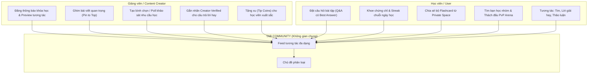
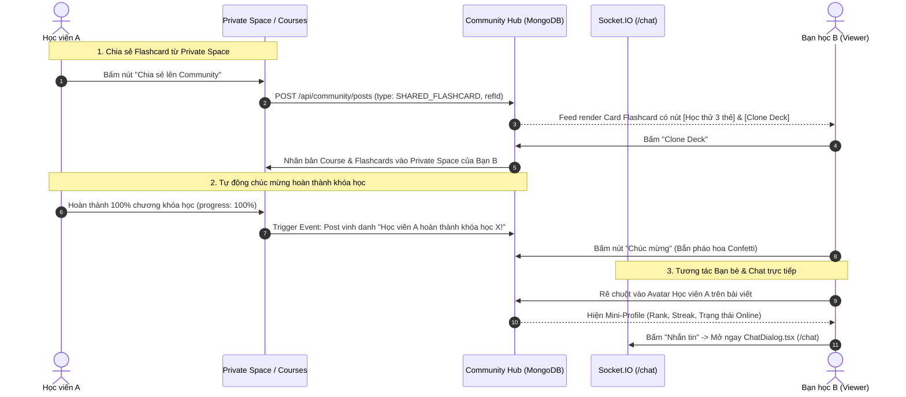
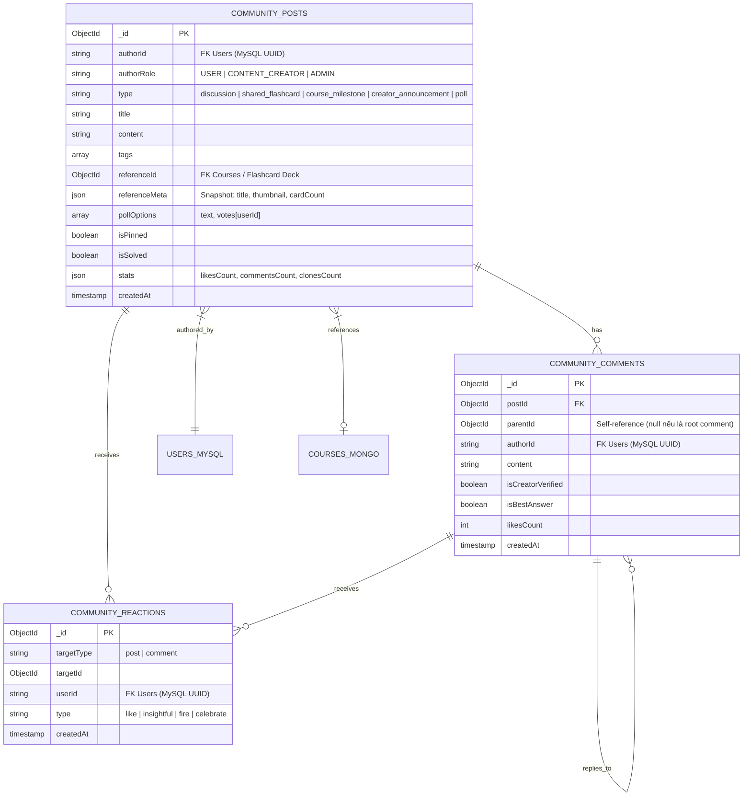
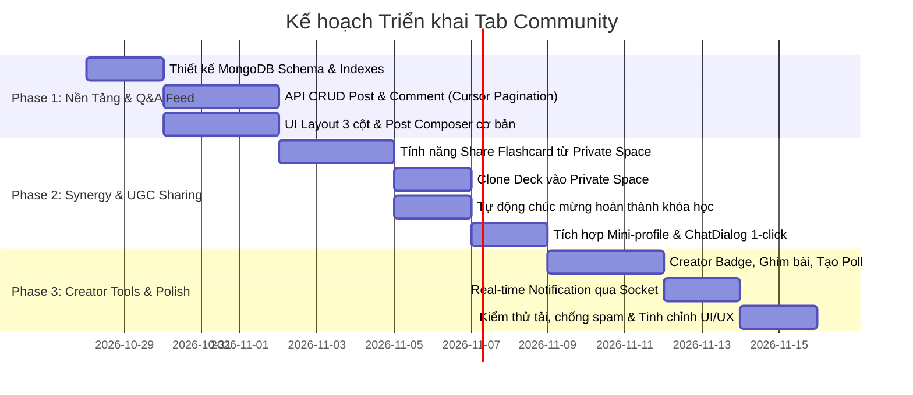

# 🌐 BẢN THIẾT KẾ KIẾN TRÚC & TÍNH NĂNG: TAB CỘNG ĐỒNG (COMMUNITY HUB)
**Dự án:** LexiCore — Nền tảng E-Learning & Gamification Học Ngoại Ngữ  
**Tác giả:** Product Manager & Senior Full-stack Architect  
**Trạng thái:** Bản thảo Đề xuất (RFC / Design Document - Ready for Review)  
**Mục tiêu cốt lõi:** Thúc đẩy tương tác xã hội (Social Engagement), tăng tỷ lệ quay lại hàng ngày (Retention Rate) và kết nối sâu sắc giữa Học viên (Learners) & Giảng viên (Creators).

---

## 1. MÔ HÌNH CỘNG ĐỒNG CỐT LÕI (CORE COMMUNITY MODEL)

### 1.1. Phân tích so sánh các mô hình mạng xã hội phổ biến

| Tiêu chí so sánh | Mô hình Social Feed (Facebook / X) | Mô hình Forum / Q&A (Reddit / StackOverflow) | Mô hình Kênh chat (Discord / Slack) | **Mô hình Đề xuất: Hybrid Social-Learning Hub** |
| :--- | :--- | :--- | :--- | :--- |
| **Bản chất nội dung** | Dòng thời gian tức thời, cảm xúc, bài post ngắn | Phân loại theo chủ đề, lưu trữ lâu dài, giải quyết bài toán | Hội thoại thời gian thực, chat theo phòng | **Kết hợp dòng thời gian giàu media + Hệ thống Channels chuyên đề** |
| **Giá trị học thuật** | Thấp (kiến thức dễ trôi sau vài giờ) | Rất cao (dễ tra cứu lại lời giải cũ) | Rất thấp (trôi tin nhắn cực nhanh) | **Cao (Bài viết gắn Tag môn học, hỗ trợ "Best Answer")** |
| **Tạo Dopamine & Viral** | Cao (Reaction, khoe ảnh, thành tích) | Trung bình (thiên về văn bản & code) | Cao (nói chuyện trực tiếp) | **Rất cao (Interactive Cards: Thẻ từ lật thử, Pháo hoa hoàn thành khóa học)** |
| **Khả năng điều phối (Moderation)** | Phức tạp, dễ loãng thông tin | Tốt nhờ phân chia Sub-hub và Vote | Rất khó kiểm soát nội dung rác | **Chặt chẽ theo Role (Creator/Admin có quyền ghim & gắn huy hiệu xác thực)** |
| **Trùng lặp với tính năng hiện có** | Không | Không | **Dẫm chân với Real-time Chat 1-1 (`/chat`)** | **Không dẫm chân: Phân tách rõ ràng giữa Bất đồng bộ (Feed) & Đồng bộ (Chat)** |

### 1.2. Đề xuất mô hình: "Hybrid Social-Learning Knowledge Hub" (Reddit-style Spaces + LinkedIn Interactive Feed)

LexiCore không nên là một mạng xã hội thuần giải trí như Facebook (dễ gây xao nhãng học tập), cũng không nên là một diễn đàn khô khan cổ điển chỉ toàn chữ như phpBB. 

Mô hình tối ưu nhất cho LexiCore là **Mô hình Lai 2 tầng (Hybrid)**:
1. **Tầng cấu trúc (Structural Layer - Reddit style):** Phân chia nội dung theo các **Spaces / Sub-topics** rõ ràng (`#IELTS-Prep`, `#Hỏi-đáp-ngữ-pháp`, `#Góc-Creator`, `#Khoe-thành-tích-Streak`, `#Giao-lưu-PvP-Arena`). Học viên không bị ngợp và có thể chọn đúng không gian mình cần giải quyết vấn đề.
2. **Tầng hiển thị tương tác (Presentation Layer - LinkedIn/X style):** Bài viết không chỉ là text thuần, mà hiển thị dưới dạng **Interactive Rich Cards**:
   - Thẻ câu hỏi bài tập có nhãn **[Cần giải đáp] / [Đã có lời giải tối ưu]**.
   - Thẻ nhúng Flashcard Deck cho phép **lật thẻ xem thử (Flip Preview)** ngay trên Feed.
   - Thẻ chúc mừng hoàn thành khóa học với **hiệu ứng pháo hoa (Confetti) & huy hiệu lấp lánh**.
   - Thẻ khảo sát (Poll) thu thập ý kiến học viên nhanh chóng.

### 1.3. Lý do lựa chọn mô hình này cho LexiCore
- **Tối ưu hóa phễu học tập (Learning Funnel):** Người học vào cộng đồng vừa để giải quyết bế tắc (Hỏi bài tập khó -> được cộng đồng/Creator trả lời), vừa để nhận sự công nhận xã hội (Social Proof: Khoe chuỗi Streak 60 ngày, nhận lời chúc mừng khi hoàn thành khóa học).
- **Khai thác tối đa nội dung do người dùng tạo (UGC - User Generated Content):** Biến kho học liệu cá nhân (Private Space) thành tài nguyên chia sẻ công cộng, giảm áp lực phải liên tục tự sản xuất nội dung của nền tảng.
- **Tôn vinh vị thế của Creator:** Tạo cho Creator một "sân khấu riêng" để xây dựng thương hiệu cá nhân, kéo học viên về các khóa học trả phí/xu của họ.

---

## 2. PHÂN TÁCH TÍNH NĂNG THEO VAI TRÒ (ROLE-BASED FEATURES)



### 2.1. Dành cho Giảng viên / Creator (`role: 'content_creator'` hoặc `'admin'`)
*Mục tiêu: Xây dựng uy tín, phát triển tệp người theo dõi và bán/phổ biến nội dung học tập.*

1. **Huy hiệu Định danh độc quyền (Creator Badge):**
   - Mọi bài đăng và bình luận của Creator tự động có huy hiệu viền tím/vàng `[Instructor / Creator]` kèm danh hiệu môn thế mạnh (ví dụ: `IELTS 8.5 Specialist`).
2. **Đăng thông báo ra mắt khóa học (Course Launch Announcements):**
   - Đăng bài với giao diện đính kèm đặc biệt: Hiển thị thumbnail khóa học, số bài học, đánh giá sao và **nút học thử (Demo Preview)** hoặc đăng ký trực tiếp bằng xu.
3. **Quyền Ghim bài viết (Pin Posts):**
   - Được phép ghim tối đa 2 bài viết quan trọng ở đầu Topic của mình hoặc trên trang hồ sơ Creator (ví dụ: Quy định lớp học, Lộ trình học ngữ pháp cấp tốc, Lịch livestream Q&A).
4. **Tạo Poll / Khảo sát tương tác (Interactive Polls):**
   - Đăng bài khảo sát lấy ý kiến học viên trước khi làm khoá học mới (ví dụ: *"Tuần tới các bạn muốn thầy làm bộ Flashcard về chủ đề Phrasal Verbs hay Business Communication?"*).
5. **Cấp chứng nhận lời giải (Creator-Verified Answer):**
   - Khi học viên thảo luận bài tập, Creator có quyền bấm nút **"Đánh dấu lời giải chuẩn mực"**. Bình luận đó sẽ tự động được đưa lên đầu danh sách bình luận kèm viền xanh nổi bật.
6. **Khen thưởng học viên (Reward Distribution / Tipping):**
   - Creator có thể tặng một lượng xu nhỏ (ví dụ: 10 - 50 coins trích từ ví creator) trực tiếp cho học viên có đóng góp tích cực nhất trong bài thảo luận.

### 2.2. Dành cho Học viên (`role: 'user'`)
*Mục tiêu: Tháo gỡ khó khăn khi học, kết nối bạn bè, tìm động lực qua gamification.*

1. **Đăng bài hỏi đáp bài tập (Homework Help & Questioning):**
   - Soạn câu hỏi kèm ảnh chụp màn hình bài kiểm tra (Exam) hoặc đoạn phát âm trong Shadowing đang gây khó khăn.
   - Gắn nhãn `[Cần giải đáp]`. Khi có học viên khác hỗ trợ đúng, chủ bài đăng có thể bấm **"Chọn câu trả lời hay nhất" (Mark as Best Solution)** -> Người trả lời tự động nhận +20 Exp và +10 Xu.
2. **Khoe thành tích & Cột mốc học tập (Milestone Show-off):**
   - Chia sẻ thành tích tự hào: Chuỗi Streak (30, 60, 100 ngày), Thăng hạng PvP Arena (đạt rank Diamond/Master), hoặc Hoàn thành 100% Khóa học.
   - Bài đăng đi kèm frame ảnh vinh danh sắc nét và nút "Gửi lời chúc mừng" (kích hoạt hiệu ứng Confetti).
3. **Tìm bạn học nhóm & Đối thủ PvP (Study Buddy & PvP Partner Finder):**
   - Gắn thẻ `#TimBanHoc` kèm target điểm (IELTS 6.5, TOEIC 750, Daily Speaking).
   - Trên bài viết có nút tương tác trực tiếp: **"Gửi lời mời kết bạn"** hoặc **"Thách đấu PvP Arena ngay"**.
4. **Chia sẻ tài nguyên tự tạo (UGC Sharing):**
   - Chia sẻ các bộ Flashcard tâm đắc đang lưu trong `Private Space` để các bạn khác cùng ôn tập và đánh giá sao.

---

## 3. TÍCH HỢP VỚI HỆ SINH THÁI HIỆN TẠI (SYSTEM SYNERGY)
*Tab Community không phải một hòn đảo cô lập. Giá trị lớn nhất của nó là trở thành chất keo kết dính toàn bộ các tính năng rời rạc của LexiCore.*



### 3.1. Chia sẻ Bộ Flashcard từ Private Space lên Community
- **Vị trí tích hợp:** Trong giao diện `PrivateSpaceView.tsx` (Tab Flashcards), bổ sung thêm một nút hành động dạng IconButton hoặc Dropdown: **"Chia sẻ lên Cộng đồng" (Share to Community)** bên cạnh nút *"Ôn tập ngay"* và *"Chỉnh sửa"*.
- **Luồng hoạt động (User Flow):**
  1. Người dùng bấm "Chia sẻ lên Cộng đồng" tại một bộ thẻ (ví dụ bộ: *"300 Từ vựng IELTS Nâng cao - 45 thẻ"*).
  2. Một Modal xuất hiện:
     - Cho phép chọn Space/Chủ đề đăng: `#IELTS`, `#Vocabulary`, `#Daily-English`.
     - Nhập caption mô tả kinh nghiệm học bộ thẻ này.
     - Tùy chọn: *"Cho phép người khác Clone về học"* (Mặc định: Bật).
  3. Khi bấm "Đăng bài", hệ thống tạo một bản ghi `CommunityPost` với `type: 'shared_flashcard'` và `referenceId: courseId`.
- **Hiển thị trên Feed:**
  - Card bài viết chứa một **Interactive Deck Widget**:
    - Header: Tên bộ thẻ, ảnh thumbnail, tác giả, tổng số thẻ (badge).
    - Giữa: Mini carousel cho phép lật thử 3 thẻ từ đầu tiên (người dùng bấm vào thẻ là flip mặt trước/sau ngay trên feed mà không cần chuyển trang).
    - Footer: Nút CTA màu hồng nổi bật **"Thêm vào Private Space của tôi" (Clone Deck)**. Khi bấm, backend sẽ clone toàn bộ thẻ sang tài khoản người xem và tăng counter `clones_count` của tác giả.

### 3.2. Tự động đăng bài / Bật Modal chúc mừng khi hoàn thành 100% Khóa học
- **Vị trí tích hợp:** Kết nối trực tiếp với backend `student-course.controller.ts` tại hàm `completeCourse()` và component `CourseCompletion.tsx` ở frontend.
- **Luồng kích hoạt kép (Dual Trigger Flow):**
  1. **Tự động hóa có kiểm soát (Opt-in Modal):**
     - Khi học viên hoàn thành bài học cuối cùng và đạt `progressPercentage = 100%`, giao diện `CourseCompletion.tsx` xuất hiện với pháo hoa `Confetti.tsx`.
     - Ngay tại màn hình vinh danh này, hiển thị một nút CTA rực rỡ: **"Khoe thành tích lên Community (+30 Exp & 20 Coins thưởng)"**.
     - Nếu học viên bấm xác nhận: Hệ thống tự động tạo bài viết dạng `course_milestone` với nội dung được chuẩn hóa:
       > *"🎉 Chúc mừng bạn [Tên User] đã xuất sắc hoàn thành 100% khóa học [Tên Khóa Học] sau [X giờ học] tích lũy! Hãy cùng gửi lời chúc mừng nào!"*
  2. **Hiệu ứng xã hội trên Community Feed:**
     - Khung bài viết có viền Gradient vàng ánh kim (Golden Glow Border).
     - Đính kèm thẻ Chứng nhận hoàn thành (Certificate Preview).
     - Nút reaction đặc biệt: **"Chúc mừng" (Celebrate)**. Khi người đọc bấm vào, màn hình của họ bắn ra hiệu ứng pháo hoa thu nhỏ và tác giả nhận được thông báo in-app: *"Bạn B vừa chúc mừng thành tích của bạn!"*.

### 3.3. Tích hợp sâu Hệ thống Bạn bè & Nhắn tin Real-time (`SocialContext.tsx` & `/chat`)
- **Tái sử dụng hạ tầng hiện có:** Dự án đã có sẵn `SocialContext` với Socket.IO namespace `/chat`, quản lý đầy đủ danh sách bạn bè (`friends`), lời mời kết bạn (`sentRequests`, `receivedRequests`), trạng thái trực tuyến (`onlineUserIds`) và hộp thoại chat nổi `ChatDialog.tsx`.
- **Cơ chế tương tác 1-Click trên Community:**
  1. **User Hover Card (Mini Profile Popover):**
     - Khi rê chuột hoặc click vào Avatar/Tên người đăng bài hoặc bình luận: Hiển thị một Card popover nhỏ gọn:
       - Avatar + Trạng thái Online (chấm xanh lá dựa theo `onlineUserIds.has(userId)`).
       - Cấp độ Level, Chuỗi ngày học Streak (`Flame icon`), Hạng Rank Arena (`Swords icon`).
  2. **Nút "Nhắn tin" (Direct Message):**
     - Bấm nút "Nhắn tin" trên Popover sẽ kích hoạt hàm `openChatWithFriend(author)` từ `useSocial()`. 
     - Giao diện `ChatDialog.tsx` lập tức bật lên, tự động chuyển vào phòng hội thoại 1-1 với tác giả bài viết đó mà không làm mất trang Community đang đọc dở.
  3. **Nút "Kết bạn linh hoạt" (Dynamic Friend Button):**
     - Tự động thay đổi trạng thái theo dữ liệu từ `SocialContext`:
       - Chưa là bạn: Hiển thị nút `[+ Kết bạn]`.
       - Đã gửi lời mời: Hiển thị `[Đang chờ duyệt]`.
       - Đối phương gửi lời mời cho mình: Hiển thị `[Chấp nhận kết bạn]`.
       - Đã là bạn: Hiển thị `[Bạn bè ✓]`.
  4. **Nút "Thách đấu PvP":**
     - Đưa thẳng cả hai vào hàng chờ thách đấu từ vựng của `ArenaView.tsx`.

---

## 4. ĐỀ XUẤT KIẾN TRÚC GIAO DIỆN (UI/UX ARCHITECTURE)

### 4.1. Bố cục không gian tổng thể (3-Column Layout)
*Trang Community được thiết kế theo phong cách Modern Clean SaaS, đồng bộ màu sắc và ngôn ngữ thiết kế của LexiCore (tương thích cả Dark/Light Mode).*

```
+---------------------------------------------------------------------------------------------------+
|                                          HEADER CHUNG                                             |
+---------------------+-------------------------------------------------------+---------------------+
| LEFT SIDEBAR        | MAIN CONTENT (COMMUNITY FEED)                         | RIGHT SIDEBAR       |
| (w-64 - Navigation) | (flex-1, max-w-2xl - Central Activity Stream)         | (w-80 - Widgets)    |
|                     |                                                       |                     |
| 📂 BỘ LỌC CHÍNH     | ✍️ [Hộp tạo bài viết: Bạn muốn chia sẻ gì hôm nay?]    | 🏆 TOP CREATORS     |
| • Dành cho bạn      |    [📷 Ảnh] [🧠 Flashcard] [📊 Poll] [🏷️ Chọn chủ đề] | • Thầy Alex (IELTS) |
| • Đang theo dõi     |                                                       | • Cô Mai (Grammar)  |
| • Thảo luận nóng    | 📌 [PINNED POST: Hướng dẫn tham gia CLB Luyện nói]    |                     |
| • Hỏi đáp bài tập   |                                                       | 🔥 TRENDING TOPICS  |
|                     | 🃏 [POST TYPE: SHARED FLASHCARD]                      | • #IELTSWritingTask2|
| 🏷️ CHỦ ĐỀ (TOPICS)  |    - Avatar + Tên + Badge Creator                     | • #PhrasalVerbs     |
| • #IELTS-Preparation|    - Lật thử 3 thẻ từ mẫu trực tiếp                   | • #DailyStreak100   |
| • #Grammar-Q&A      |    - Nút: [Thêm vào Private Space (1.2k clones)]      |                     |
| • #Flashcard-Decks  |    - Reaction: Tim (45) | Bình luận (12) | Share      | ⚡ BẢNG VINH DANH    |
| • #Chinh-phuc-PvP   |                                                       | • Top cứu trợ bài   |
| • #Goc-Thao-Luan    | 🎓 [POST TYPE: COURSE MILESTONE]                      | • Top streak cao    |
|                     |    - Khung hào quang + Bằng chứng nhận hoàn thành     |                     |
| 👥 NHÓM CỦA TÔI     |    - Nút: [Chúc mừng (Bắn pháo hoa)]                  | ⚔️ TÌM ĐỐI THỦ PVP  |
| • IELTS 7.0+ Target |                                                       | • 5 bạn đang online |
| • English for IT    | ❓ [POST TYPE: HOMEWORK HELP]                         |   [Thách đấu ngay]  |
|                     |    - Screenshot đề thi trắc nghiệm khó                |                     |
|                     |    - [Lời giải hay nhất từ Bạn C - Creator Verified]  |                     |
+---------------------+-------------------------------------------------------+---------------------+
```

### 4.2. Chi tiết từng khu vực giao diện

#### A. Cột trái: Bộ điều hướng chủ đề (Left Navigation & Spaces)
- **Menu lọc nhanh:** 
  - *Dành cho bạn (For You):* Thuật toán hiển thị các bài viết liên quan đến các khóa học học viên đang đăng ký (`enrolledCourses`).
  - *Đang theo dõi (Following):* Chỉ hiển thị bài đăng từ bạn bè và các Creator mà học viên ấn Follow.
  - *Cần giải đáp (Unanswered):* Lọc các câu hỏi học tập chưa có lời giải tối ưu.
- **Danh sách Channel / Topic Tag:** Các nhãn nổi bật có icon sinh động, click vào là lọc tức thì bài viết theo chủ đề.
- **Nút "Tạo nhóm học tập mới":** Cho phép mở rộng tạo sub-group theo nhu cầu ôn thi.

#### B. Cột giữa: Dòng tin tương tác (Main Feed Stream)
- **Hộp tạo bài viết thông minh (Smart Post Composer):**
  - Input tinh gọn, click vào mở rộng khung soạn thảo Rich Text.
  - Nút đính kèm chuyên dụng:
    - `[Chọn bộ Flashcard từ Private Space]` -> Mở Drawer chọn nhanh bộ thẻ của mình.
    - `[Tạo bình chọn / Poll]` -> Cho phép nhập 2 - 4 lựa chọn và đặt thời hạn kết thúc.
    - `[Đính kèm ảnh/screenshot]`.
    - `[Chọn chủ đề / Topic tag]` (Bắt buộc để phân loại).
- **Trình bày thẻ bài viết (Card Layouts):**
  - **Header bài viết:** Avatar, Tên tác giả, Badge vai trò (`Creator`/`User`), Thời gian tương đối (`2 giờ trước`), Menu ba chấm (Báo cáo, Lưu bài viết, Xóa bài nếu là tác giả).
  - **Nội dung:** Văn bản hỗ trợ định dạng, hashtag có thể click, ảnh có chức năng phóng to Lightbox.
  - **Khu vực bình luận (Nested Comment Drawer):**
    - Bình luận cấp 1 + Lời hồi đáp cấp 2.
    - Huy hiệu `[Lời giải được xác nhận]` ghim ngay dưới bài viết câu hỏi.
    - Tích hợp phím tắt Ctrl+Enter để gửi bình luận nhanh.

#### C. Cột phải: Các tiện ích thúc đẩy giữ chân (Right Widgets & Retention)
- **Top Creators tuần:** Danh sách giảng viên tích cực nhất kèm nút "Theo dõi" nhanh.
- **Bộ Flashcard đang thịnh hành (Trending Decks):** Top 3 bộ thẻ từ vựng cộng đồng được Clone nhiều nhất trong tuần, có số lượt tải và đánh giá sao.
- **Khu vực Thách đấu nhanh PvP:** Danh sách bạn bè/người dùng cùng trình độ đang Online với nút gọi đấu từ vựng tức thì.

### 4.3. Phân tích tái sử dụng các UI Components sẵn có trong Source Code

Dự án hiện có một thư viện UI Component cực kỳ phong phú và hoàn thiện (dựa trên Radix UI & Tailwind CSS). Chúng ta có thể **tái sử dụng 100% không cần cài thêm thư viện ngoài**:

| Component có sẵn | File đường dẫn | Mục đích ứng dụng trong Community View |
| :--- | :--- | :--- |
| `Card`, `CardContent`, `CardHeader` | `frontend/src/app/components/ui/card.tsx` | Khung bao phủ cho Post item, Widget sidebar, Composer |
| `Avatar`, `AvatarImage`, `AvatarFallback` | `frontend/src/app/components/ui/avatar.tsx` | Hiển thị avatar người đăng bài, người bình luận, mini-profile |
| `Badge` | `frontend/src/app/components/ui/badge.tsx` | Gắn nhãn phân loại: Topic `#IELTS`, Vai trò `Creator`, Trạng thái `Đã giải đáp` |
| `Button` | `frontend/src/app/components/ui/button.tsx` | Nút Like, Reply, Clone Deck, Nhắn tin, Thách đấu |
| `Dialog`, `AlertDialog` | `frontend/src/app/components/ui/dialog.tsx` | Modal tạo bài viết nâng cao, Modal xác nhận Clone bộ thẻ, Modal phóng to ảnh |
| `DropdownMenu` | `frontend/src/app/components/ui/dropdown-menu.tsx` | Nút menu thao tác 3 chấm góc bài viết (Lưu, Sửa, Xóa, Báo cáo) |
| `HoverCard` / `Popover` | `frontend/src/app/components/ui/hover-card.tsx` | Mini Profile hiện lên khi di chuột qua Avatar tác giả |
| `ScrollArea` | `frontend/src/app/components/ui/scroll-area.tsx` | Cuộn danh sách bình luận dài mà không làm vỡ layout trang |
| `Tabs`, `TabsList`, `TabsTrigger` | `frontend/src/app/components/ui/tabs.tsx` | Chuyển đổi giữa các tab Feed ("Dành cho bạn", "Đang theo dõi", "Thảo luận") |
| `Confetti` | `frontend/src/app/components/dashboard/Confetti.tsx` | Bắn pháo hoa khi bấm chúc mừng bài viết hoàn thành khóa học |
| `toast` | `sonner` | Thông báo thành công: "Đã lưu bài viết", "Đã clone bộ thẻ vào Private Space" |
| `ChatDialog` | `frontend/src/app/components/global/ChatDialog.tsx` | Hộp thoại chat trực tiếp 1-1 khi bấm "Nhắn tin" với tác giả |

---

## 5. THỬ THÁCH KỸ THUẬT & CƠ SỞ DỮ LIỆU (TECHNICAL CHALLENGES)



### 5.1. Chiến lược Database: Tại sao nên dùng MongoDB cho Community?
Dự án LexiCore áp dụng triệt để kiến trúc **Polyglot Persistence** (ghi nhận trong `project-roadmap.md`):
- **MySQL:** Phụ trách dữ liệu giao dịch cứng, ACID, số dư ví tiền (`wallets`), người dùng (`users`), bạn bè (`friendships`), tin nhắn 1-1 (`conversations`, `messages`).
- **MongoDB:** Phụ trách toàn bộ dữ liệu nội dung mềm, biến động nhanh, phi cấu trúc và dung lượng lớn (Logs học tập, Flashcards, Creator Studio).

👉 **Lựa chọn chính xác cho Module Community: MongoDB (Mongoose Schema)**.
*Lý do:*
1. **Schema đa hình (Polymorphic Posts):** Một bài viết chia sẻ Flashcard cần lưu `referenceMeta` (số lượng thẻ, danh sách thẻ mẫu), một bài Poll cần lưu mảng các phương án và ID người vote, một bài Milestone cần lưu thông số khoá học. MongoDB xử lý các kiểu dữ liệu lồng nhau (Nested JSON/BSON) tốt hơn MySQL gấp nhiều lần mà không cần JOIN nhiều bảng phức tạp.
2. **Khả năng ghi nhận tương tác cao (High Write Throughput):** Các thao tác thả tim, tăng view, bình luận diễn ra liên tục. MongoDB có tốc độ ghi vượt trội.
3. **Đánh Index linh hoạt:** Hỗ trợ đánh Compound Index đa trường và Full-text search cho tìm kiếm bài viết.

#### Thiết kế Index tối ưu hóa truy vấn Feed:
```javascript
// 1. Phục vụ lấy danh sách Feed chính & phân trang Compound Cursor O(log N + limit)
CommunityPostSchema.index({ isDeleted: 1, createdAt: -1, _id: -1 });

// 2. Phục vụ lấy danh sách Feed lọc theo chủ đề
CommunityPostSchema.index({ isDeleted: 1, topic: 1, createdAt: -1, _id: -1 });

// 3. Phục vụ hiển thị bài viết được ghim lên đầu
CommunityPostSchema.index({ isDeleted: 1, isPinned: -1, createdAt: -1 });

// 4. Phục vụ lọc các câu hỏi chưa được giải quyết
CommunityPostSchema.index({ isDeleted: 1, isSolved: 1, createdAt: -1 });

// 5. Ngăn chặn một User thả tim trùng lặp trên cùng một bài post / bình luận
CommunityReactionSchema.index({ targetType: 1, targetId: 1, userId: 1 }, { unique: true });
```

---

### 5.2. Giải pháp Kỹ thuật cho các bài toán phức tạp

#### A. Phân trang hiệu năng cao: Compound Cursor-based Pagination (Infinite Scroll)
- **Vấn đề của Offset Pagination (`skip / limit`):**
  - Khi học viên lướt Feed vô tận (Infinite Scroll), nếu dùng `skip(100).limit(10)`, MongoDB vẫn phải quét qua 100 bản ghi đầu tiên trước khi trả về 10 bản ghi tiếp theo -> Rất chậm khi trang càng sâu (O(N)).
  - Nếu trong lúc người dùng đang lướt mà có bài viết mới được đăng, các bài viết ở trang sau sẽ bị trượt xuống và người dùng sẽ thấy cùng một bài lặp lại 2 lần.
- **Giải pháp Compound Cursor (createdAt, _id):**
  - Sử dụng cặp khoá `(createdAt, _id)` được mã hoá Base64 dạng JSON `{ t: ISOString, i: string }`. Khách hàng (client) chỉ việc truyền chuỗi `cursor` lên mà không cần quan tâm nội dung bên trong.
  - Phục vụ truy vấn MongoDB:
    ```typescript
    if (cursor) {
      query.$or = [
        { createdAt: { $lt: cursor.createdAt } },
        { createdAt: cursor.createdAt, _id: { $lt: new Types.ObjectId(cursor.id) } },
      ];
    }
    // Sắp xếp nhất quán:
    CommunityPost.find(query).sort({ createdAt: -1, _id: -1 }).limit(limit + 1)
    ```
  - **Bài ghim (Pinned Posts):** Tách riêng truy vấn chỉ nạp ở trang đầu tiên (`cursor === null`), loại bỏ khỏi danh sách bài viết phân trang để tránh phá vỡ trật tự B-Tree Index.
  - Độ phức tạp đạt mức tối ưu **O(log N + limit)** nhờ Index `{ createdAt: -1, _id: -1 }`. Không bao giờ bị mất bài hay lặp bài kể cả khi nhiều bài có cùng `createdAt`.

---

#### B. Quản lý bình luận đa cấp (Nested Comments)
- **Phân tích mô hình phân cấp:**
  - *Mô hình cây sâu vô hạn (Reddit style):* Bình luận con lồng bình luận cháu lồng bình luận chắt... -> Giao diện trên thiết bị di động bị thụt lề quá nhiều khiến nội dung bị co rúm thành một cột dọc hẹp, trải nghiệm UX rất tệ.
  - *Mô hình 2 cấp (Facebook / TikTok style - KHUYÊN DÙNG):*
    - **Cấp 1 (Root Comment):** Bình luận trực tiếp vào bài viết (`parentId = null`).
    - **Cấp 2 (Replies):** Mọi lời hồi đáp đều trỏ về ID của Root Comment tương ứng (`parentId = rootCommentId`), đính kèm `@mention` tên người được trả lời.
- **Ưu điểm vượt trội:**
  - Giao diện sạch sẽ, chỉ thụt lề 1 lần duy nhất (indent 36px).
  - Tối ưu hóa truy vấn: Khi mở bài viết, chỉ cần fetch các Root Comments trước. Học viên bấm "Xem 5 câu trả lời..." thì frontend mới tải tiếp các bình luận con của nhánh đó -> Tiết kiệm 80% băng thông tải trang.

---

#### C. Xử lý Notification & Socket Real-time
- **Tận dụng bảng `notifications` (MySQL) & Socket.IO (`/chat`):**
  - Trong MySQL đã có sẵn bảng `notifications` với các trường: `user_id`, `type`, `title`, `body`, `is_read`. Ta chỉ cần bổ sung các enum type: `'community_comment'`, `'community_best_answer'`, `'community_celebrate'`.
- **Cơ chế chống nghẽn và chống Spam thông báo (Throttling / Debouncing):**
  - Nếu một bài viết nhận được 100 lượt thả tim trong 5 phút, ta **KHÔNG** gửi 100 thông báo riêng lẻ làm tê liệt chuông thông báo của tác giả.
  - Sử dụng Redis hoặc memory cache để gom nhóm thông báo:
    - *"Bạn Lan và 4 người khác đã thả tim bài viết của bạn."*
- **Bắn sự kiện Real-time qua Socket:**
  ```typescript
  // Khi có người bình luận hoặc thả tim:
  const targetUserRoom = `user:${authorId}`;
  chatNamespace.to(targetUserRoom).emit('notification', {
    id: notificationId,
    type: 'community_comment',
    title: 'Bình luận mới',
    body: `${currentUser.fullName} đã trả lời câu hỏi của bạn.`,
    createdAt: new Date(),
    is_read: false
  });
  ```

---

## 6. LỘ TRÌNH TRIỂN KHAI DỰ KIẾN (IMPLEMENTATION PHASES)
*Sau khi tài liệu này được xem xét và thông qua, công việc sẽ được chia thành 3 Phase khoa học:*



- **Phase 1 (Core Foundation & Basic Feed):**
  - Xây dựng 3 Model MongoDB (`CommunityPost`, `CommunityComment`, `CommunityReaction`).
  - Viết bộ API Controller với Cursor Pagination.
  - Thay thế `CommunityView.tsx` tĩnh bằng Layout 3 cột hoàn chỉnh, kết nối API lấy Feed thật.
- **Phase 2 (Ecosystem Synergy - Giá trị cốt lõi):**
  - Tích hợp nút "Chia sẻ lên Community" trong `PrivateSpaceView.tsx`.
  - Tích hợp Interactive Flashcard Card trên Feed và nút "Clone Deck".
  - Tích hợp Hook hoàn thành khóa học từ `student-course.controller.ts` & `CourseCompletion.tsx`.
  - Kết nối Mini-profile Popover với `useSocial()` để mở `ChatDialog.tsx` và gửi kết bạn.
- **Phase 3 (Creator Tools, Gamification & Real-time):**
  - Quyền Ghim bài viết, huy hiệu Creator, tính năng tạo Poll bình chọn.
  - Cơ chế chọn "Best Answer" nhận thưởng Exp/Xu.
  - Bắn realtime notification qua Socket namespace `/chat`.

---

> [!TIP]
> **Tóm tắt giá trị mang lại:**  
> Bản thiết kế này giải quyết triệt để vấn đề "học tập đơn độc" trên các nền tảng online. Bằng cách biến các tài nguyên cá nhân (Flashcards, Khóa học, Thành tích Streak) thành nội dung tương tác xã hội nhiều màu sắc, tab **Community** sẽ trở thành thỏi nam châm giữ chân học viên quay lại LexiCore mỗi ngày.
